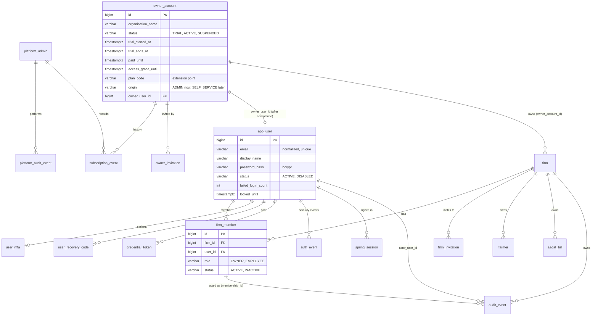

# Mandi Book: authentication, authorization and multi-firm isolation blueprint

**Version 2 (revision of 2026-10-20).** Supersedes version 1 of this file. **Design only: nothing here is implemented.** No application code, dependency, configuration, migration, database object, test or business data was changed to produce it, and nothing was committed. **This is not a claim that Mandi Book is production-ready; section 18 lists what must still be true first.**

## 0. Scope, sources, conventions

* **Primary source of truth:** this repository (code, migrations, tests, documents) and read-only checks of the local synthetic development stack. Authentication is designed for this product from first principles.
* **Permission levels, account recovery and registration rules** beyond what this document states are **unresolved**, and nothing below assumes them.
* **Tags:** **[F]** confirmed fact (read from the repository or dev stack) · **[R]** recommendation (default awaiting approval) · **[A]** assumption needing technical verification · **[D]** decision or business input needed. Decisions the product owner already made carry **[AP-n]** (section 2.1).
* **Other documents are not changed by this task.** Statements elsewhere that this version contradicts are listed in section 13.4.
* **What changed from version 1:** owner-centric model and a **separate platform-administrator authority with no access to firms** (section 3); `OPERATOR` replaced by `EMPLOYEE`; email login and BCrypt (was a login name and Argon2id); sessions 18 h absolute / 30 min idle (was 12 h); optional owner MFA with recovery codes; subscription lifecycle; the demo bypass bean is replaced by real login with seeded synthetic accounts; audit actor columns recommended on `audit_event` itself (version 1 recommended a companion table); firms are created by owners, not by an operator command.

---

## 1. Executive summary

**Where we are [F].** Every business table carries `firm_id` with composite foreign keys; services take the firm from the `CurrentFirm` seam; ids load only through `...AndFirmId`; the runtime database role `mandi_app` is restricted and verified; audit history is append-only. **There is no authentication or authorization:** all 11 `/api/**` routes (plus actuator health and info) are open; the firm is one configured constant (`SingleFirmContext`); the audit actor is the constant `anonymous`. The backend listens on `0.0.0.0:8081` and PostgreSQL on `0.0.0.0:5433`, and the database owner is a superuser with a documented default password; whether other machines can actually reach them is **not verified** (section 12.3).

**The design in brief [R unless marked AP].**
* **Three authorities, kept apart.** Business users (`OWNER`, `EMPLOYEE`, per firm membership); the **platform administrator**, who may manage *owner accounts only* and has **no access to any firm or business data, and cannot impersonate an owner [AP-1]**; and database/infrastructure operators, who are outside the application (section 3).
* **The platform boundary is architectural, not a UI rule.** Separate identity table, authentication chain, session store, cookie and authority namespace; a separate module and deployable application; a separate database role that has **no privileges on any business table, including `firm`**; ArchUnit and database-privilege tests (section 3.3 and 14).
* **Owner-centric tenancy.** One owner login can create any number of firms (no application-enforced limit [AP-3]). Employees reach only firms they were explicitly assigned to through an explicit `firm_member` row. The tenant boundary stays the firm (`firm_id`, composite foreign keys); there are no scattered `owner_id` comparisons.
* **Authentication.** Spring Security, server-side sessions in PostgreSQL, email + BCrypt, HttpOnly/SameSite cookie, CSRF, throttling, optional owner MFA (TOTP + recovery codes), 18-hour absolute and 30-minute idle limits enforced on the server [AP-5].
* **Lifecycle.** Account/subscription status (trial 14 days, active, suspended; expired trial **derived**) is separate from login status and from membership status (section 10).
* **Incremental delivery.** Authentication, then one vertical slice (Farmers master) with cross-firm isolation proof, then the rest (section 15).

**Findings that need action before any real use [F].** (1) The API is unauthenticated and bound to all interfaces. (2) The default database owner password is documented. (3) **The `DEFAULT` firm created by migration V4 exists in every environment, including production; it must be inactive and unowned there** or be adopted by an explicit approved procedure (section 13.2). (4) The admin-assisted recovery that the owner asked for **conflicts with the no-impersonation rule unless an independent delivery channel exists**: the conflict and the options are in section 7.4 and are a launch blocker.

---

## 2. Decision register

### 2.1 Decisions approved by the product owner (instructions of 2026-10-20)
| ID | Decision |
|---|---|
| AP-1 | **Platform administrator manages owner accounts only**: provisioning/invitations, account status, trial and subscription lifecycle, necessary account-level metadata. They have **absolutely no access to firms or business data** (no listing, opening, creating, editing or deleting firms; no farmers, buyers, bills, expenses, ledgers or other firm records; no impersonation of an owner), including through direct APIs, repositories, database-backed admin services, support tools or inherited permissions. Enforced server-side as an authorization **and architecture** boundary, with automated tests that use valid firm and owner ids. A future support need must **not** silently grant business-data access; it requires a separate, explicitly approved security design. |
| AP-2 | Owner-centric model: platform admin provisions or invites owners; an owner has one login; the owner invites, assigns, deactivates and manages employees; employees access only assigned firms; owner, user, firm, membership and employee-to-firm relations are modelled explicitly (not scattered `owner_id` checks); public self-registration not required initially; onboarding is administrator-controlled with an extensible path to a public trial. |
| AP-3 | An owner may create multiple firms with **no application-enforced firm-count limit**. |
| AP-4 | Two business roles initially, `OWNER` and `EMPLOYEE`, with the same broad functional permissions; the owner additionally manages firm settings and employee memberships; platform administration is a separate authority; permissions and policy checks are centralized so later restrictions are easy; no configurable-permissions UI yet. |
| AP-5 | Spring Security with **server-side sessions** (no JWT in browser storage); email + password; BCrypt through Spring Security's encoders; Secure/HttpOnly/SameSite cookies; CSRF for state-changing cookie-authenticated requests; login and recovery abuse controls; explicit logout invalidating the server session; multiple simultaneous sessions/devices initially; **optional owner MFA** with recovery codes and an audited recovery flow; session invalidation after password reset, suspension or other security changes; **no production authentication bypass or demo identity**. |
| AP-6 | Session policy: **absolute maximum 18 hours**; idle timeout proposed at 30 minutes (usability trade-off to be documented); both enforced server-side; warnings before expiry where feasible; re-authentication after expiry. |
| AP-7 | Recovery: generic responses, short-lived single-use random tokens, secure storage, abuse prevention, session revocation after reset, administrator-assisted recovery while email is unavailable. |
| AP-8 | An owner signs in once and selects among authorized firms; the server verifies the active firm on every request; a client-supplied firm id is never trusted; no silent cross-firm writes when another tab changes firm; narrow repositories, architecture tests and cross-firm tests; RLS is optional defence in depth (assessed, not enabled). |
| AP-9 | Audit: events identify the authenticated user and membership where available; the actor never comes from the browser. |
| AP-10 | Authentication status, employee membership status and commercial subscription status are separate. Trial is 14 days with server-recorded timestamps; `TEST` is not a commercial status; admin can manually activate, renew or suspend; no automatic data deletion on expiry or suspension; no firm-count limits; future plan limits are extension points. |
| AP-11 | Deployment baseline (section 12) and the urgent verification of the reported `0.0.0.0` listeners and default database password. |
| AP-12 | Identity migrations start at **V6**; the plan is incremental: authenticate, protect a vertical slice, prove cross-firm isolation, then expand. |

### 2.2 Recommended defaults awaiting approval
| ID | Recommendation | Section |
|---|---|---|
| RD-1 | Platform administration is a **separate deployable application** (own module and process, own database role and schema), not a route group inside the business application | 3.3 |
| RD-2 | Platform admins have **mandatory MFA**; the first platform admin is created by a documented out-of-band step with the database owner credential | 3.3, 7 |
| RD-3 | Owner and employee identity is one `app_user` table keyed by **normalized email**; platform admins live in a different table | 4 |
| RD-4 | `firm_member` is the single place that says who can act in which firm, with `OWNER` and `EMPLOYEE` roles; exactly one `OWNER` membership per firm (the account's owner); co-owners and ownership transfer deferred | 4 |
| RD-5 | BCrypt cost 12 (to be measured), maximum password 72 bytes enforced with a clear message (no silent truncation) | 6.2 |
| RD-6 | Idle timeout 30 minutes with user-activity keep-alive and a 5-minute warning; no heartbeat polling | 6.4 |
| RD-7 | Expired trial is a **derived** state computed from stored timestamps with database time; stored states are `TRIAL`, `ACTIVE`, `SUSPENDED` | 10 |
| RD-8 | Trial starts when the owner **accepts the invitation**, not when the admin creates the account | 10 |
| RD-9 | Audit: add nullable `actor_user_id`, `membership_id`, `request_id` to `audit_event` (simpler than a companion table) | 9 |
| RD-10 | Replace the demo-authentication bean of version 1 with **real login using seeded synthetic accounts** in the `demo` profile only | 13.3 |
| RD-11 | Multi-tab safety by a firm check header on every business request (not a firm selector) | 8.3 |
| RD-12 | No grace period for an expired trial; per-account `access_grace_until` set manually by the admin as the only grace mechanism | 10 |
| RD-13 | Platform console starts as a small command-line/admin tool; a web UI is optional later | 3.3 |

### 2.3 Questions requiring team/business input
| ID | Question |
|---|---|
| Q-1 | **Email delivery:** which provider or channel, and when? It is a precondition for safe recovery and invitations (sections 7 and 7.4). |
| Q-2 | Admin-assisted recovery when email is unavailable: which compensating controls are acceptable, or is email required before real onboarding (recommended)? |
| Q-3 | Grace period after a paid period lapses (read-only for N days?) and what an expired or suspended owner may still do (for example export their own data) |
| Q-4 | Data retention after expiry or suspension (how long, who may request deletion, what is the process) and legal/privacy obligations for names of farmers, buyers and users |
| Q-5 | Is a trial extension by the admin allowed? Is the 14-day trial one per owner or per email? |
| Q-6 | Starter data for a new firm: the three confirmed items (A11: onion, potato, garlic), and anything else |
| Q-7 | Who are the platform administrators, how many, how are they vetted, and who holds the database owner credential (the administrator must not) |
| Q-8 | Should employee invitations to an email that already has an account require the invitee's explicit acceptance (recommended) and what does the invitee see about the inviting owner |
| Q-9 | What may an `EMPLOYEE` **not** do later (the first restrictions the business will want)? Not yet decided |
| Q-10 | Support needs: what situations will require help from the platform operator? (A support design is **out of scope** and requires separate approval, AP-1.) |
| Q-11 | Co-owners or ownership transfer of a firm; owner account closure |
| Q-12 | Firm naming/uniqueness rules per owner, and whether the firm code shown to users matters |

### 2.4 Assumptions requiring technical verification
| ID | Assumption (all unverified) |
|---|---|
| AV-1 | `Set-Cookie`, `Cookie`, `Origin`, `X-Forwarded-*` and `Host` behave correctly through the Next.js `rewrites` proxy (cookie attributes, `Secure` behind TLS termination, CSRF header pass-through). **Must be verified in the first spike, not assumed.** |
| AV-2 | Spring Security 7 / Boot 4.1 provide the session, CSRF and password-encoder behaviour described, including BCrypt's handling of passwords longer than 72 bytes |
| AV-3 | Spring Session JDBC sliding expiry updates on every request that touches the session and can be bypassed for a designated passive status endpoint |
| AV-4 | The per-request membership and account-status lookups are cheap enough (two to three indexed reads) |
| AV-5 | `SECURITY DEFINER` functions and cross-schema views behave as designed with the restricted roles and with `pg_dump`/restore |
| AV-6 | Two Spring Boot applications from one repository (business and platform) are practical with the current build (multi-module Maven) |
| AV-7 | RLS overhead and the transaction-local context hook in a custom `JpaTransactionManager` |
| AV-8 | A TOTP library and an email library compatible with Boot 4 are available and acceptable as new dependencies |
| AV-9 | Database time (`now()`) is the single clock for trial and session arithmetic |

---

## 3. Principals, authorities and the platform-administrator boundary

### 3.1 Three authorities, three separate worlds
| Authority | Can do | Cannot do | Identity |
|---|---|---|---|
| **Business users** (`OWNER`, `EMPLOYEE`) | Operate firms they are members of | Anything platform-level (accounts, subscriptions) | `app_user` + `firm_member` |
| **Platform administrator** | Provision and invite owners; read/update owner-account status; manage trial and subscription; read account-level metadata | **Everything that touches a firm** (section 3.2); impersonate; read secrets | `platform.platform_admin`, never in `app_user` |
| **Database/infrastructure operator** (not an application role) | Migrations, backups, break-glass recovery under a documented procedure | Is **not** a platform administrator; must not be the same person [Q-7] | database owner credential |

### 3.2 What the platform administrator must never be able to do [AP-1]
List, open, create, edit or delete **firms**; read **any** firm-owned row (farmers, buyers, villages, items, expense heads, bills, lots, expenses, audit history, future ledgers); create or alter memberships; hold a business session; **impersonate an owner** (no "log in as", no session minting for an owner, no knowledge of or ability to set an owner's password, no access to an owner's MFA secret or recovery codes, no ability to receive or read a recovery or invitation token). Counts of firms or employees are also withheld initially (not needed; no limits exist [AP-3]); if plan limits arrive later, account-level counters are maintained by the business side and read as plain numbers [D].

### 3.3 Enforcement: seven independent layers [R, all server-side]
| Layer | Mechanism | What it prevents |
|---|---|---|
| 1 Identity | `platform.platform_admin` is a different table from `app_user`; no foreign key links them; `firm_member.user_id` references `app_user` only, so a platform admin **cannot appear in any membership** | A platform admin gaining business roles by data accident |
| 2 Authentication | Separate login endpoint, `SecurityFilterChain`, **cookie name, session table and CSRF scope**, mandatory MFA [RD-2]; served on a separate origin/hostname and behind a network allow-list | A business session working on the platform side or vice versa |
| 3 Authorization | Separate authority namespace (`PLATFORM_*`) and a separate permission enum and policy class; the business `Permission` enum has no platform entries and the platform enum has no business entries. No role hierarchy joins them | "Inherited permissions" |
| 4 Code | **Separate Maven module and separate deployable** [RD-1, AV-6]: the platform module contains no firm-owned JPA entity, repository or service; business modules never import platform code. Only a tiny `contracts` module (account-status enum and interface) is shared. ArchUnit rules enforce the dependency direction | Platform code reaching business repositories, even by mistake |
| 5 Data | A separate DB role `mandi_platform` with grants **only on schema `platform`** (and `SELECT` on one limited view of owner identity); **`REVOKE ALL` on schema `public` and every business table, including `firm`, `firm_member`, `audit_event`, `credential_token`, MFA tables and sessions**. The business role `mandi_app` has no table grants in `platform`; it reaches platform data only through the **contract surface** below | Direct SQL, injected SQL or repository misuse from the platform side returning business data (fails with `permission denied`) |
| 6 Network | The platform application is not proxied by the business Next.js app and is reachable only from an allow-listed network | Exposure to business users and the public internet |
| 7 Audit | `platform.platform_audit_event` (append-only, own triggers) records every admin action; owner-visible account events are shown to the owner | Silent administrator action |

**Contract surface between the two worlds (the only ways data crosses) [R]:**
| Channel | Direction | Content |
|---|---|---|
| View `public.account_access` | business reads | owner account id, stored status, trial/paid timestamps, grace, derived effective status; **no** personal data |
| Function `public.accept_owner_invitation(token_hash, user_id)` (`SECURITY DEFINER`, owned by the migration role) | business writes | validates the invitation, links the new `app_user` to the owner account, starts the trial |
| View `platform.owner_user_summary` | platform reads | `app_user` columns **id, email, display_name, status, last_login_at, mfa_enabled (boolean)** only; **never** password hash, MFA secret, recovery codes, tokens, sessions |
| View `public.account_event_view` | business reads | owner-visible events about *their own* account (renewal, suspension) |
No other grants cross the boundary. A test enumerates the grants of both roles and fails on any difference from this table.

### 3.4 Operations that exist and operations that must not exist
Platform routes (section 11.3): provision an owner account and send its invitation; resend an invitation; read an owner account's status/trial/subscription; activate, renew, suspend, reinstate; trigger a recovery email to the **registered** address; read account events and the platform audit. **Must not exist and are asserted absent by a route-enumeration test:** any route that accepts, returns or filters by a firm id; any route under `/platform` that lists firms; "impersonate"/"login as"; any endpoint that returns a token, password, hash, MFA secret or recovery code; any endpoint changing an owner's login email without owner confirmation (section 7.4).

### 3.5 Support access (future) [AP-1]
None is designed. If a support requirement appears, it needs a **separate, explicitly approved security design** (for example owner-granted, time-boxed, read-only, audited, visible to the owner). Nothing in this blueprint grants or implies it. The only people who can technically read business data are holders of the database owner credential or backups; that is a policy and secret-management matter (section 12), not an application role.

---

## 4. Identity and ownership model

### 4.1 Entities (explicit relationships, not `owner_id` comparisons)
| Concept | Table | Schema | Notes |
|---|---|---|---|
| Person who signs in (owner or employee) | `app_user` | public (global) | one row per email; may be owner, employee or both |
| Commercial account of an owner | `owner_account` | platform | subscription/trial; managed by the platform admin; one per owner user |
| Firm (tenant) | `firm` (exists, V4) | public | gains `owner_account_id` (nullable at first); `active` already exists |
| Who may act in which firm | `firm_member` | public | the **only** source of authorization to a firm; role `OWNER` or `EMPLOYEE`; status `ACTIVE`/`INACTIVE` |
| Pending employee invitation | `firm_invitation` | public | token hash, email, role, expiry |
| Pending owner invitation | `owner_invitation` | platform | token hash, email, expiry |
| Platform administrator | `platform_admin` | platform | separate world (section 3) |

The **tenant boundary remains the firm**: `firm_id` on every business row, composite foreign keys, firm-scoped queries. Ownership of a firm by an owner is the single relation `firm.owner_account_id`, used for subscription gating, and the owner's authority inside the firm comes from their `OWNER` membership row, so **all authorization decisions go through memberships**, one mechanism.

### 4.2 ER diagram

Mermaid shows `platform` objects and `public` objects together; section 4.3 lists which schema each lives in.

### 4.3 Table definitions [R]
**Schema `public` (business application, role `mandi_app`):**
| Table | Key columns and constraints |
|---|---|
| `app_user` | PK `id identity`; `email varchar(254) NOT NULL` stored **lower-cased and trimmed**, `CHECK (email = lower(email))`, unique; `display_name varchar(200)`; `password_hash varchar(100) NOT NULL` (`{bcrypt}` prefix via the delegating encoder); `status` CHECK (`ACTIVE`,`DISABLED`); `failed_login_count`, `locked_until`; `password_changed_at`, `last_login_at`, `email_verified_at`, `created_at`. Never physically deleted. Reserved for the future and **not added now**: external identity-provider subject columns (additive later) |
| `user_mfa` | PK `user_id` FK; `secret_ciphertext bytea` (application-level encryption, key from the secret store, `key_id` for rotation); `enabled_at`; `last_used_step bigint` (TOTP replay protection); `failed_count` |
| `user_recovery_code` | `id`, `user_id` FK, `code_hash`, `batch_id`, `used_at`; ten single-use codes per batch; regenerating invalidates the batch |
| `credential_token` | `id`, `user_id` FK, `purpose` CHECK (`PASSWORD_RESET`,`EMAIL_VERIFY`), `token_hash bytea` **unique**, `expires_at`, `consumed_at`, `superseded_at`, `created_at`, `requested_ip_hash`. Only the **SHA-256 of a 256-bit random token** is stored |
| `firm_invitation` | `id`, `firm_id` FK, `email`, `role` CHECK (`EMPLOYEE`), `token_hash` unique, `expires_at`, `accepted_at`, `revoked_at`, `invited_by_membership_id` |
| `firm_member` | PK `id identity`; `firm_id`, `user_id` FKs; **unique `(firm_id, user_id)`**; **unique `(id, firm_id)`** (target for composite foreign keys from audit); `role` CHECK (`OWNER`,`EMPLOYEE`); `status` CHECK (`ACTIVE`,`INACTIVE`); `created_by_user_id`, `deactivated_at/by`; **partial unique index: one `OWNER` per firm** (`unique (firm_id) where role = 'OWNER'`). Rows are never deleted |
| `firm` (alter) | add `owner_account_id bigint NULL` (FK to `platform.owner_account`); `NOT NULL` for production firms once the `DEFAULT` firm question is settled (13.2); the firm `code` becomes an **opaque generated value** (it is globally unique today; users must not choose it) [Q-12] |
| `auth_event` | append-only global security log: `event_type`, `user_id` nullable, `email_hmac` nullable (never the raw email for unknown users), `ip_hash`, `request_id`, `details`, `created_at`; written in its own transaction so failures persist |
| `auth_throttle` | `key_hash`, `window_start`, `attempts`: DB-backed counters shared by all instances |
| Spring Session JDBC tables | standard `SPRING_SESSION`, `SPRING_SESSION_ATTRIBUTES`; principal name = `u:<userId>` (never the email) |

**Schema `platform` (platform application, role `mandi_platform`):** `platform_admin` (+ own `platform_admin_mfa`, `platform_admin_recovery_code`), `owner_account`, `owner_invitation`, `subscription_event` (append-only), `platform_audit_event` (append-only), and its own session tables (`PLATFORM_SESSION*`).

**`owner_account` constraints:** `status` CHECK (`TRIAL`,`ACTIVE`,`SUSPENDED`); `TRIAL` requires `trial_started_at` and `trial_ends_at`; `origin` CHECK (`ADMIN`,`SELF_SERVICE`); `owner_user_id` unique where not null; `plan_code` text default `'STANDARD'` (extension point); `version` for optimistic locking. No firm-count column or limit exists [AP-3].

### 4.4 Is a person in several firms, or under several owners, supported initially?
* **Several firms of the same owner: supported from the start** (one `firm_member` row per firm; the firm switcher lists them).
* **Several owners: supported by the data model from the start** (membership is user-to-firm; it carries no owner id) and by the firm switcher, which lists all assigned firms. What is **deferred**: any owner-specific per-user settings, cross-owner reporting, and conflict handling if two owners invite the same email beyond "each invitation is accepted separately". An invitation to an existing account must be **accepted by the invitee while signed in** (Q-8); an owner can never attach a person to a firm without that person's consent, and an invitation never reveals whether the email already has an account.
* **An owner who is also an employee elsewhere:** allowed. Owner-ness is a property of the **membership**, not of the user, so there is no privilege carry-over.
* **No firm-count limit [AP-3]:** the firm switcher and `GET /api/v1/auth/firms` are **paged and searchable** (the pick-list cap lesson of `DB_INDEXES_AND_QUERIES.md` section 5 applies); `/auth/me` returns the active firm and a count, not the whole list.

### 4.5 Onboarding (administrator-controlled) and the path to a public trial
1. A platform admin provisions an owner account (organisation name, owner email) and a **14-day trial or active** state; the system emails an invitation to that address. The admin **never receives the token** (7.4).
2. The owner opens the link, sets a password (and may enable MFA) → `app_user` created, linked to `owner_account`, trial clock starts [RD-8].
3. The owner creates firms (`POST /api/v1/firms`); each creation adds the firm, the **explicit** `OWNER` membership, and starter data in one transaction, with an audit event.
4. The owner invites employees per firm; each accepts and gets an `EMPLOYEE` membership.
**Future public trial:** `owner_account.origin = 'SELF_SERVICE'` plus the same email-verification token mechanism creates an account in `TRIAL`; no identity redesign is needed (identity, tokens, membership and lifecycle are unchanged; only the entry point and abuse controls are new).

---

## 5. Authorization model

### 5.1 Roles and permissions [AP-4]
Initial roles `OWNER` and `EMPLOYEE` have the **same broad functional permissions**; the owner additionally holds the firm and membership permissions.
| Permission | `OWNER` | `EMPLOYEE` |
|---|---|---|
| `BILL_READ`, `BILL_CREATE`, `MASTER_READ`, `MASTER_CREATE`, `MASTER_UPDATE`, `MASTER_DEACTIVATE`, `AUDIT_READ` (history of entities they can read) | yes | yes |
| `FIRM_SETTINGS_MANAGE` | yes | no |
| `MEMBER_MANAGE` (invite, deactivate, reactivate, list employees) | yes | no |
| `FIRM_CREATE` (account-level: needs an owner account in `TRIAL`/`ACTIVE`) | yes | no |
| `SECURITY_EVENTS_READ` (membership and sign-in events of the firm) | yes | no |
| Edit/cancel saved bills | not built (rule unconfirmed, Q9) | not built |
Whether employees should be limited further is open [Q-9]; the design makes that a one-place change.

### 5.2 Centralization (no scattered role checks)
1. One `Permission` enum and one `RolePermissions` map (a single class). No controller or service compares a role name; an ArchUnit rule fails the build if the strings or constants `OWNER`/`EMPLOYEE` appear outside the policy package and the persistence layer.
2. One `Policy` component with a single entry point, for example `policy.require(Permission.BILL_CREATE)` (and `policy.require(permission, resourceRef)` where a resource is involved), used through one annotation (for example `@RequiresPermission`) wired to Spring's method security; controllers declare the permission, they do not decide.
3. **Inputs to every decision:** authenticated user; membership of the **active** firm (role, status); firm status; owner-account effective status (section 10); the permission; and, for resource access, that the resource belongs to the active firm. Resource ownership is enforced by the narrow repositories (and RLS later), so a decision never relies on a loose `owner_id` comparison.
4. The decision returns allow or a machine-readable denial reason (`NO_MEMBERSHIP`, `MEMBERSHIP_INACTIVE`, `FIRM_INACTIVE`, `ACCOUNT_BLOCKED`, `PERMISSION_DENIED`), logged with request id, never shown with detail to the client beyond a localized generic message.
5. **Future restrictions:** change `RolePermissions`, or later add a per-membership override table (not built); add plan-based limits through a `LimitPolicy` hook that currently returns "unlimited" [AP-10].
6. Platform authority is a **different** enum and policy (section 3.3); the two never share a type.

---

## 6. Authentication and sessions

### 6.1 Why server-side sessions here [AP-5]
Same-origin browser app behind one proxy; sessions can be revoked **immediately** (delete rows, by user or by device); no token for scripts to steal; membership and subscription state are checked per request anyway; there is no cross-organisation single sign-on requirement. **Revisit JWT or an external identity provider** if any of these appear: native mobile or third-party API clients that cannot use cookies; single sign-on across products or organisations; a requirement for managed MFA, social login or enterprise directory; independent services that must validate identity without the session store; regulatory demand for a certified identity service. The schema leaves room (additive identity-provider columns); Spring Security supports OIDC login later.

### 6.2 Mechanics [R]
* **Identifier and password:** normalized email; BCrypt via Spring Security's `DelegatingPasswordEncoder` (`{bcrypt}` prefix, so the algorithm can change later); cost 12 pending a measurement on the target machine [RD-5]. **BCrypt processes at most 72 bytes**; Devanagari characters use 3 bytes each, so a 72-byte limit is about 24 Hindi characters: enforce a clear maximum and message (no silent truncation) [AV-2]. Minimum length and a common-password check; no composition rules [D on exact values].
* **Cookie:** `__Host-` prefix with `Secure` in production (so `Path=/`, no `Domain`), `HttpOnly`, `SameSite=Lax` (Strict would break arriving from emailed links as a signed-in user), **no `Max-Age`/`Expires`** (a browser-session cookie; the cookie lifetime is **not** a security control). Development over plain HTTP uses an unprefixed name with `Secure` off; production profile fails to start with insecure cookie settings.
* **CSRF:** enabled; `XSRF-TOKEN` cookie readable by the same-origin page, echoed in `X-XSRF-TOKEN` on `POST/PUT/PATCH/DELETE` including login and logout; additionally reject unsafe requests whose `Origin` is present and not allow-listed; verify behaviour through the Next proxy (**AV-1, to be tested, not assumed**).
* **Session fixation:** new session id at login and at MFA completion.
* **Abuse controls:** generic login failure text; equal work for unknown users; per-account counter and temporary lock (`failed_login_count`, `locked_until`); per-IP and per-email throttles in `auth_throttle` (works across instances) plus proxy-level limits; the same for recovery and invitation endpoints; every failure and lock written to `auth_event`. A captcha is deferred [D].
* **Logout:** `POST /api/v1/auth/logout` deletes the server session; the cookie is cleared.
* **Multiple devices:** unlimited concurrent sessions initially; `GET /auth/sessions` and `DELETE /auth/sessions/{id}` let a user see and end other sessions; a future per-user/plan limit is an extension point.
* **Invalidation triggers:** password change or reset; MFA enabled, disabled or reset; email change; user disabled; **owner-account suspension (the owner's sessions)**; the user pressing "sign out everywhere". Membership deactivation does **not** kill a session (the user may have other firms); it blocks that firm on the next request (section 8).

### 6.3 Optional owner MFA, recovery codes and recovery flow [AP-5]
* **Enrollment (owner-initiated):** authenticator-app TOTP (RFC 6238). The secret is shown once as a QR/text, becomes active only after the owner enters a valid code, and is stored **encrypted** (`user_mfa.secret_ciphertext`, key from the secret store, `key_id` for rotation). Ten recovery codes are generated, shown **once**, and stored only as hashes.
* **Login with MFA:** password success creates a **partial-authentication** state (`PRE_MFA`): a short-lived (5 minutes) session with **no authorities**, limited attempts, rejected by every business route and by `/auth/me` beyond "MFA required". Only a valid TOTP or an unused recovery code upgrades it to a full session (new session id). TOTP steps cannot be reused (`last_used_step`). **When MFA is enabled it cannot be skipped**; there is no admin switch to bypass it.
* **Recovery codes:** single-use; using one raises a notification email and an `auth_event`; the owner is prompted to regenerate when fewer than three remain; regenerating invalidates the old batch.
* **Lost device and lost codes (audited recovery flow) [D]:** the platform admin **cannot** disable an owner's MFA. Recovery is a request recorded by the owner, requires identity verification (a documented procedure), notifies the owner's registered email, applies a **cooling-off delay** (for example 48 hours) during which the owner can cancel, requires **dual control by two platform admins**, resets MFA only (not the password), revokes all sessions, and writes `auth_event`, `platform_audit_event` and an owner-visible account event. Because an MFA reset plus a password reset equals account takeover, **both together are never allowed in one admin-assisted step** (section 7.4).
* **Platform admins:** MFA mandatory [RD-2].
* Employees: MFA is not offered initially (extension point).

### 6.4 Session policy [AP-6]
| Setting | Value | Enforcement |
|---|---|---|
| **Absolute lifetime** | **18 hours** from the moment of authentication (re-set on MFA completion), **fixed, never extended** by any activity | Server: `authenticatedAt` stored in the session; a filter invalidates the session when `now > authenticatedAt + 18 h` regardless of activity, including activity on the same day after midnight |
| **Idle timeout** | **30 minutes** (proposal) | Server: Spring Session `maxInactiveInterval` 1800 s, sliding; `EXPIRY_TIME` in the session table |
| Cookie lifetime | session cookie (no explicit expiry) | Browser-side convenience only |
| Session-store cleanup | Spring Session JDBC cleanup job (for example every 5 minutes) removes rows past `EXPIRY_TIME` | Housekeeping only: **an expired row is rejected on read even if cleanup has not yet removed it** (the check never depends on the job) |
| Warnings | the client shows "session ends in 5 minutes" and offers "stay signed in" | **Not a security control**; the server alone decides expiry |
These three expirations (cookie, server session, store cleanup) are independent and documented separately; each has its own test.

**What counts as qualifying activity [R].** A request resets the idle timer **only if it is a user-initiated request that reaches the session layer**: navigation, saving, searching, type-ahead while typing, switching firm, and an explicit keep-alive. **Background polling must not keep a session alive**: (1) the frontend does **not** poll any authenticated endpoint; (2) the expiry-warning countdown uses the expiry times that every normal response already returns in headers (`X-Session-Idle-Expires-At`, `X-Session-Absolute-Expires-At`); (3) a single **passive** endpoint, `GET /api/v1/auth/session`, reports remaining time **without touching** the idle timer (served outside the session-touching path [AV-3]); (4) a **keep-alive** (`POST /api/v1/auth/keepalive`) is sent by the page only after **real keyboard or pointer input**, at most once per five minutes, so an unattended tab cannot generate it; and (5) the 18-hour absolute cap is independent of all of the above, so even a compromised page that fakes activity cannot extend a session beyond 18 hours.

**Usability trade-off for bill entry [D].** A clerk may type a long bill for more than 30 minutes without any server request (typing in numeric cells does not call the API), so the idle timer can expire mid-entry. Mitigations: the keep-alive on genuine input; the 5-minute warning; the in-page re-login dialog that keeps the form data in memory (section 8.5); and idempotent bill creation so a retried save cannot duplicate. If testing with real clerks shows 30 minutes is too short, raise the idle timeout (for example to 60 minutes) rather than weaken the absolute cap; decision [D] after a usability test.

---

## 7. Password recovery and onboarding

### 7.1 Recovery flow (all users, email delivery) [AP-7, R]
1. `POST /auth/recovery/request {email}` always answers **202 with the same generic text and similar timing**, whether or not the email exists. Work is queued (email sending is asynchronous) so response time does not reveal existence.
2. If the account exists and is active, a token is created: **256 bits from `SecureRandom`**, URL-safe; **only its SHA-256 is stored** (`credential_token.token_hash`, unique); `expires_at` = **30 minutes**; creating a new token marks earlier ones `superseded_at`.
3. The email carries a link with the token in the URL **fragment** (not sent to servers in `Referer` or logs); the page POSTs it; responses carry `Referrer-Policy: no-referrer`.
4. `POST /auth/recovery/reset {token, newPassword[, secondFactor]}` consumes the token **atomically** (`UPDATE ... SET consumed_at = now() WHERE token_hash = ? AND consumed_at IS NULL AND superseded_at IS NULL AND expires_at > now() RETURNING user_id`), so a token works once even under concurrency; applies the password policy; **revokes all of the user's sessions**; writes `auth_event`; sends a "your password was changed" notification. **If MFA is enabled, a TOTP or recovery code is required too**, so a stolen mailbox alone is not enough.
5. **Abuse prevention:** per-email (for example 3 per hour), per-IP and global limits in `auth_throttle`; no account lock from recovery requests (to prevent denial-of-service against a user); expired and consumed tokens are cleaned up by a global job (no firm context).
6. An invitation acceptance uses the same primitive (`owner_invitation`, `firm_invitation`, 7-day expiry).

### 7.2 Email normalization
Trim, Unicode normalization (NFKC), lower-case; stored and compared in that form; display form kept separately only if needed.

### 7.3 Employee recovery
Same flow. An owner may **trigger** a reset email to an employee but **never sets an employee's password or sees a token**.

### 7.4 Administrator-assisted recovery while email is unavailable: a conflict with AP-1
The owner asked for administrator-assisted recovery if email delivery is not yet available [AP-7], **and** that the platform admin must never impersonate an owner [AP-1]. These conflict: if the administrator can read or set any secret that grants access (a recovery token, an invitation link, a temporary password, a changed login email), **they can take over the account**. Design consequences [R]:
* **Tokens, links, temporary passwords and recovery codes are never returned to the platform administrator** by any API or screen, and are never logged. The administrator can only trigger the **system** to send them to the owner's **registered** address.
* **The administrator cannot change an owner's login email.** Changing it requires confirmation from the owner (a link to the old address, then to the new), otherwise "change email, then recover" is a takeover.
* **Without an independent delivery channel there is no safe administrator-assisted recovery.** Options for the product owner [Q-1, Q-2]:
  1. **Email delivery required before real onboarding (recommended).** Development and tests use a mail sink that exists only in the `demo`/test profiles and shows tokens to developers, never in production.
  2. If something must ship earlier: a **break-glass** procedure requiring two named administrators, identity verification of the owner out-of-band, a cooling-off delay, an owner-visible notice on next sign-in, a `platform_audit_event`, and forced MFA for the account; it is a **detective, not preventive**, control and is a **residual risk to accept explicitly**.
  3. Owner-held recovery codes (section 6.3) as the first line: the owner generates and keeps them, so most lockouts never need the administrator.
This is listed as a **launch blocker** (section 17).

---

## 8. Firm selection and tenant isolation

### 8.1 Request lifecycle
```mermaid
sequenceDiagram
    participant B as Browser
    participant N as Next.js (proxy.ts + rewrites)
    participant S as Spring Security chain (business)
    participant F as Firm-context filter
    participant P as Policy (@RequiresPermission)
    participant V as Service (CurrentFirm)
    participant T as Firm-scoped transaction manager
    participant D as PostgreSQL
    B->>N: request (session cookie, X-XSRF-TOKEN on writes, X-Mandi-Firm-Check)
    N->>S: forwarded (cookie, Origin preserved: AV-1)
    S->>S: load session (idle + absolute check), CSRF, Origin
    S-->>B: 401 / 403 (CSRF) / PRE_MFA rejected
    S->>F: authenticated user
    F->>D: membership (active firm, user) + firm status + account_access (reads)
    F-->>B: 409 FIRM_SELECTION_REQUIRED / 409 FIRM_MISMATCH / 403 NO_MEMBERSHIP, FIRM_INACTIVE, ACCOUNT_BLOCKED
    F->>P: FirmContext (firmId, userId, membershipId, role, requestId)
    P-->>B: 403 PERMISSION_DENIED
    P->>V: call service
    V->>T: begin transaction
    T->>D: set_config('app.firm_id', firmId, true)   (only when RLS is enabled)
    V->>D: firm-scoped queries; audit_event with actor columns, same transaction
    T->>D: COMMIT (context disappears)
    V-->>B: response (+ X-Request-Id, session expiry headers)
```

### 8.2 Rules [R]
1. **Active firm.** Stored in the **server session** only; set by `POST /auth/active-firm` after a membership check; automatic when the user has exactly one active membership; otherwise firm-scoped routes answer `409 FIRM_SELECTION_REQUIRED`.
2. **Client-supplied firm ids.** Never used to choose the firm. Any `firmId` in a body, query, path or header on a business route is ignored (as `FirmIsolationIntegrationTest` already proves for `firmId`, `X-Firm-Id`, `X-Firm`); resources are found by id inside the active firm only.
3. **Verification on every request.** Membership `ACTIVE` for `(activeFirm, user)`, firm `active`, owner-account effective status allows access. Two or three indexed reads [AV-4]; no cache in the MVP, so revocation, suspension and expiry apply on the **next request**.
4. **Foreign ids:** another firm's resource id gives **404**; a foreign id inside a request body gives **422**; switching to a firm without membership gives **403** (identical for a nonexistent firm). No response reveals that a record exists in another firm.
5. **Narrow repositories.** Firm-owned repositories extend `Repository<T, ID>` (not `JpaRepository`) and expose only `findByIdAndFirmId`, a firm-scoped `findAll(Specification)`, and `save`, so unscoped `findById`, `findAll()`, `deleteById` do not compile [F: today they do compile (section 11.2)]. **Architecture tests** (ArchUnit): no `EntityManager`, `JdbcTemplate` or native query outside an allow-list; no `@Scheduled`/`@Async` bean touching firm data except through `FirmJobRunner`; no role-name strings outside the policy package; platform packages never depend on business packages.
6. **Background jobs.** None exist today [F]. Any future job runs through `FirmJobRunner.runAs(firmId, actor = "system:<job>", work)`, which builds the same `FirmContext` and transaction; it never has an ambient firm. Global jobs (session cleanup, token cleanup) touch only global tables.
7. **Error semantics.** `401` no/expired session or `PRE_MFA`; `403` forbidden (permission, no membership, inactive firm, account blocked, CSRF); `404` not found in this firm; `409` firm selection or mismatch; `422` business rule or foreign reference; `423` locked; `429` throttled.

### 8.3 Stale firm context in other tabs [AP-8]
Tabs share one session, so if tab B switches firm, tab A still shows the old firm. **Every business request (reads and writes) carries `X-Mandi-Firm-Check: <firm id the page believes it is in>`**; the server compares it with the session's active firm and answers `409 FIRM_MISMATCH` without executing the request. The header never chooses a firm. Tab A shows "the firm changed in another tab; reload". Stronger alternative if needed later [D]: put the firm in the URL path (`/firms/{id}/...`) validated per request.

### 8.4 Cross-owner and suspended-owner situations
A firm's access also depends on its **owner's** account state: if the owner's account is suspended or its trial expired, **employees of that owner's firms are blocked too** (they get `ACCOUNT_BLOCKED` with an employee-appropriate message), while the same employee's firms under another owner keep working.

### 8.5 PostgreSQL row-level security: assessment (optional defence in depth; **not enabled**) [AP-8]
| Topic | Assessment |
|---|---|
| Purpose | A database-level second lock: even a missing `firm_id` predicate, a native query, or injected SQL through the runtime role sees only the current firm |
| Tenant context | A transaction-local setting set at the start of every transaction: `select set_config('app.firm_id', :id, true)` through a custom `JpaTransactionManager` subclass; only the transaction-local form is allowed |
| Pooled connections | The local setting disappears at commit or rollback, so it cannot leak to the next user of a pooled connection and is compatible with PgBouncer transaction pooling; a test with a pool of size 1 interleaves firm A, no context and firm B |
| Fail closed | Policies use `firm_id = nullif(current_setting('app.firm_id', true), '')::bigint`; an unset or emptied setting yields NULL, so **no rows are visible or writable**; statements outside any transaction have no context and see nothing |
| Migration ownership | Policies are created by the migration/owner role; `ENABLE ROW LEVEL SECURITY` without `FORCE`, so the owner (Flyway, backups) keeps working; the runtime role is not the owner and not `BYPASSRLS` (already proved by `RuntimePrivilegesIntegrationTest`) |
| Runtime grants | Policies do not replace grants: `R__runtime_grants.sql` and the matrix test continue to govern table privileges; new tables need both a grant and an RLS policy (a guard test fails otherwise) |
| Tables outside RLS | Global tables (`firm`, `firm_member`, `app_user`, invitations, tokens, sessions): membership must be read **before** a firm context exists. They are protected by grants and by queries that always include the user id |
| Platform isolation | RLS is irrelevant to the platform boundary, which is enforced by grants and module separation (section 3.3) |
| Recommendation | **Do not activate until** (1) authentication and the firm context exist and the cross-firm suite passes; (2) the guard tests (every firm table has a policy), the context-leak tests and the missing-context tests are written and green; (3) overhead is measured on the synthetic dataset and accepted [AV-7]; (4) the migration rollback `DISABLE ROW LEVEL SECURITY` is rehearsed. Then enable it in a later phase as the second lock; keep explicit scoping regardless |
| Hibernate `@TenantId` | Not adopted (touches eight entities, native SQL bypasses it, overlaps RLS); optional later spike |

### 8.6 Frontend behaviour for firm selection (summary; details in section 15, phase 6)
Firm switcher (paged and searchable because there is no firm-count limit), confirmation when a form has unsaved changes, hard reload after a switch, and a direct visit to another firm's record shows the ordinary "not found" page with no hint that it exists elsewhere.

---

## 9. Audit history [AP-9]

### 9.1 Facts [F]
`audit_event(id, entity_type, entity_id, action, details varchar(1000), actor varchar(100) NOT NULL default 'anonymous', created_at, firm_id)`; triggers block UPDATE, DELETE and TRUNCATE; `AuditService.record` runs with `Propagation.MANDATORY` in the change's transaction; the runtime role has `SELECT, INSERT` only. `V4` already added `firm_id` to this table with `ADD COLUMN ... DEFAULT` and no trigger fired.

### 9.2 Option comparison
| Criterion | Option 1: nullable columns on `audit_event` | Option 2: companion `audit_event_context` table |
|---|---|---|
| Preserves existing history | Yes: old rows get NULL; nothing is rewritten (no UPDATE, so the triggers never fire; adding a nullable column without default is a metadata change) | Yes |
| Integration with append-only triggers | Unchanged: triggers guard UPDATE/DELETE/TRUNCATE; the new columns are written by the same INSERT | A second table needs its own identical triggers, grants and a consistency check that `firm_id` matches the parent |
| Atomicity | One INSERT, one row | Two INSERTs that must both happen; a forgotten context row is possible |
| Query ("who did this") | One table | A join; context may be missing |
| Risk to existing code | Small: the entity gains optional fields | Smaller schema change, more code |
| Extensibility | Each later field is another `ALTER ... ADD COLUMN` | One new column per field in a separate table, still an ALTER |
| Simplicity | **Simpler** | More moving parts |
**Recommendation [RD-9]: Option 1.** Add to `audit_event`: `actor_user_id bigint NULL` (FK to `app_user`), `membership_id bigint NULL` (composite FK `(membership_id, firm_id)` to `firm_member (id, firm_id)`, which keeps the audit row and the membership in the same firm), `request_id uuid NULL`. Keep writing the text `actor` for compatibility as `user:<userId>` (stable identifier, not a name) or `system:<job>`. The role at the time can be recovered from `membership_id` unless the role changes; if the exact role at the time must be preserved, add `role_at_time varchar(20) NULL` [D]. This is an additive migration with its own rollback (drop the columns) and does not alter any existing row.

### 9.3 Rules
* **Never from the browser:** the actor columns come only from the server-side `FirmContext`; no request field is read for them.
* **Historical anonymous events:** remain exactly as they are (`actor = 'anonymous'`, new columns NULL). They are **never backfilled or guessed**. The UI labels them "recorded before sign-in was introduced".
* **Transaction rollback:** business audit rows commit or roll back with the change (unchanged). **Authentication and security events** (failed logins, lockouts, recovery, MFA, session revocation) are written to the global `auth_event` table in their **own transaction**, so they persist even when no business transaction exists or it fails; platform actions go to `platform.platform_audit_event`.
* **Request id:** a filter assigns a UUID per request, puts it in the logging context with user and firm ids, returns it as `X-Request-Id`, and stores it in `audit_event.request_id`.
* **Membership deactivation:** `firm_member` rows are never deleted, so an old event still resolves to the membership that acted, even if now `INACTIVE`.
* **Name display:** history shows the user's **current** display name resolved from `app_user` through `actor_user_id`; erasure of a person is by anonymizing the single `app_user` row without touching append-only data (the retention policy is permanent, A14; the anonymization policy remains open [Q-4]). Storing the name at the time would preserve exact history but make anonymization impossible without breaking append-only protection.
* **Who can read audit history [R, D]:** both roles can read the history of entities they can read; the firm-level security and membership event log is `OWNER` only; the platform administrator **cannot** read any business `audit_event` (no grant).

### 9.4 Historical snapshots on business documents (recommendation; **needs business confirmation**)
Bills reference masters by id, so renaming a master changes how an old bill looks. Recommended **display snapshots written at save time** [D on exact field list]: firm name and print header fields; farmer name (English and Hindi); village name; each lot's item name (English and Hindi) and buyer name; each expense head name. Recommended **calculation-relevant snapshots only after the rules are confirmed**: item unit and commission percentage, expense basis, rates and order, rounding rule, the rule-set id (already stored on the bill). **Accounting and snapshot rules are unconfirmed (`business-rules.md`) and must not be implemented before a worked example exists.** Sequencing: display snapshots can precede accounting; calculation snapshots cannot.

---

## 10. Account and subscription lifecycle [AP-10]

### 10.1 Three separate status axes
| Axis | Stored on | Values | Changed by | Effect |
|---|---|---|---|---|
| Authentication status | `app_user.status` plus `failed_login_count`/`locked_until` | `ACTIVE`, `DISABLED`; temporary lock | the system (lockout), operator runbook (disable) | whether the person can sign in at all |
| Membership status | `firm_member.status` | `ACTIVE`, `INACTIVE` | the firm's owner | whether the person can act in that firm |
| Commercial status | `platform.owner_account` | stored `TRIAL`, `ACTIVE`, `SUSPENDED`; derived **effective** status | the platform admin (and the invitation acceptance) | whether protected business operations of **all** the owner's firms are allowed |
Access to a business operation requires **all** of: user can sign in, membership `ACTIVE`, firm `active`, effective commercial status allows access.

### 10.2 Commercial lifecycle
| State | Meaning | Allowed |
|---|---|---|
| `TRIAL` (stored) | trial started at invitation acceptance [RD-8]; `trial_started_at` recorded by the **database** clock; `trial_ends_at = trial_started_at + 14 days` computed and stored by the server (never by a client) | normal use until `trial_ends_at` |
| `EXPIRED_TRIAL` (**derived**) | `status = 'TRIAL' and now() >= trial_ends_at` | protected business operations blocked; sign-in, account page and logout allowed; **no data deleted** |
| `ACTIVE` (stored) | manually activated or renewed by the admin; optional `paid_until` | normal use; if `paid_until` is set and passes, the derived state is `EXPIRED` (a paid-period lapse) unless `access_grace_until` is in the future [D whether paid periods exist; "renew" implies one] |
| `SUSPENDED` (stored) | admin action with a reason code | protected operations blocked; **owner's sessions revoked**; employees of that owner's firms blocked per request; **no data deleted** |
**Recommendation [RD-7]: derive "expired" rather than store it.** A stored `EXPIRED_TRIAL` would need a scheduler to flip rows, can lag behind the real boundary, and creates a state that can disagree with the timestamps; a derived state is exact at the boundary, needs no job, and cannot drift. Cost: reporting by state uses a view (`account_access.effective_status`, with an index on `trial_ends_at` for "expiring soon" reminders). Every admin transition writes an append-only `subscription_event` (who, when, from, to, reason). The clock is the database's `now()` [AV-9]. `TEST` is **not** a commercial status; development and demo use the `demo` profile and synthetic data, never a status value.

### 10.3 Grace, deactivation, recovery of access, retention
* **Grace [RD-12, Q-3]:** none automatic. The admin may set `access_grace_until` per account; during it, access continues.
* **Employee deactivation by the owner:** takes effect on the employee's next request in that firm; their other firms are unaffected; their historical audit records remain; reactivation is allowed.
* **Recovery after renewal:** purely a state change: when the admin renews or reinstates, the next request succeeds; owners re-sign in if their sessions were revoked by suspension.
* **Retention:** **no automatic deletion** on expiry or suspension. Any deletion needs an approved retention and anonymization policy and an explicit procedure [Q-4].
* **No firm-count limits [AP-3]. Extension points, not built:** `plan_code`; a future `account_limit` table (employees, concurrent sessions, devices, usage) consulted by the `LimitPolicy` hook that returns "unlimited" today; automated billing and renewal reminders as an external consumer of `subscription_event` and the `trial_ends_at`/`paid_until` index. No billing is implemented.

---

## 11. Endpoint inventory and security matrix

### 11.1 Business API today [F] (11 handler methods in 3 controllers; plus actuator and `/error`)
| # | Route | Handler | R/W | Anonymous today | Firm-scoped | Authentication required (proposed) | Permission | Account gate | CSRF | Audit | Risk if wrong user/firm |
|---|---|---|---|---|---|---|---|---|---|---|---|
| 1 | `GET /api/v1/config` | `AadatBillController.config` | R | yes | no | yes | any member | no | no | no | Low |
| 2 | `POST /api/v1/aadat/bills/preview` | `.preview` | R | yes | no | yes | `BILL_CREATE` | yes | yes | no | Low (CPU; lists unbounded) |
| 3 | `POST /api/v1/aadat/bills` | `.create` | W | yes | yes | yes | `BILL_CREATE` | yes | yes | yes (exists) | High |
| 4 | `GET /api/v1/aadat/bills/{id}` | `.get` | R | yes | yes | yes | `BILL_READ` | yes | no | no | High |
| 5 | `GET /api/v1/aadat/bills` | `.search` | R | yes | yes | yes | `BILL_READ` | yes | no | no | High |
| 6 | `GET /api/v1/masters/{type}` | `MasterController.list` | R | yes | yes | yes | `MASTER_READ` | yes | no | no | High (names) |
| 7 | `GET /api/v1/masters/{type}/page` | `.page` | R | yes | yes | yes | `MASTER_READ` | yes | no | no | High |
| 8 | `POST /api/v1/masters/{type}` | `.create` | W | yes | yes | yes | `MASTER_CREATE` | yes | yes | yes (exists) | Medium |
| 9 | `PUT /api/v1/masters/{type}/{id}` | `.update` | W | yes | yes | yes | `MASTER_UPDATE` | yes | yes | yes (exists) | Medium/High |
| 10 | `PATCH /api/v1/masters/{type}/{id}/active` | `.setActive` | W | yes | yes | yes | `MASTER_DEACTIVATE` | yes | yes | yes (exists) | Medium |
| 11 | `GET /api/v1/audit` | `AuditController.history` | R | yes | yes | yes | `AUDIT_READ` | yes | no | no | High |
| 12 | `GET /actuator/health` (`info` removed) | Spring Actuator | R | yes | no | loopback/management port only | none | no | no | no | Low |
`ApiExceptionHandler` maps 400/404/422/500 only; there is **no 401/403 path** and controllers contain **no authorization checks** [F].

### 11.2 Do any routes or code paths bypass firm scoping?
* **Confirmed: no route does today.** Every firm-touching service method uses `CurrentFirm`; a grep of `backend/src/main/java` finds no `findById(`, `findAll()`, `deleteById(` or native query; all three `@Query` methods in `AadatBillRepository` carry a firm predicate [F].
* **Confirmed structural gap:** repositories still inherit the full `JpaRepository`, so unscoped methods compile [F]. Theoretical until used. Other paths: no scheduled/async work, no exports, no Spring Data REST [F].

### 11.3 New and changed endpoints (proposed)
**Business application (principal: business user; cookie `__Host-mandi_session`):**
| Route | Auth | Permission / gate | Notes |
|---|---|---|---|
| `GET /api/v1/auth/csrf` | anonymous | none | issues the CSRF cookie |
| `POST /api/v1/auth/login`, `POST /auth/login/mfa` | anonymous (+CSRF) | throttled | generic errors; `PRE_MFA` state |
| `POST /auth/logout` | session | none | deletes server session |
| `GET /auth/me` | session | none | user, active firm, permissions, expiry times |
| `GET /auth/session` | session | none | **passive**: does not extend idle timer |
| `POST /auth/keepalive` | session | none | counts as activity (client sends it only after real input) |
| `GET /auth/firms?q&page&size` | session | none | paged list of the user's active memberships (name, role, owner organisation name) |
| `POST /auth/active-firm` | session | membership check | sets the session's active firm |
| `POST /auth/recovery/request`, `POST /auth/recovery/reset` | anonymous (+CSRF) | throttled; MFA factor if enabled | section 7 |
| `POST /auth/invitations/accept` | anonymous token (owner activation, new employee) or session (existing user) | token | creates `app_user` or membership |
| `POST /auth/password` | session | current password | revokes other sessions |
| `POST /auth/mfa/enroll`, `/confirm`, `/disable`, `/recovery-codes/regenerate` | session (owner) | recent re-authentication | audited |
| `GET /auth/sessions`, `DELETE /auth/sessions/{id}` | session | own sessions only | |
| `POST /api/v1/firms` | session | `FIRM_CREATE`; account effective status must allow | creates firm + `OWNER` membership + starter data + audit in one transaction |
| `GET/PATCH /api/v1/firm` | session | `FIRM_SETTINGS_MANAGE` for PATCH | the active firm's settings |
| `GET/POST/PATCH /api/v1/firm/members...`, `POST /firm/members/invitations`, `.../deactivate`, `.../activate` | session | `MEMBER_MANAGE` | no endpoint sets or reveals a password or token |
| All routes of 11.1 | session | as above | after the firm filter |

**Platform application (principal: platform admin; separate origin, session, cookie, CSRF) [section 3]:**
| Route | Purpose | Data touched |
|---|---|---|
| `POST /platform/auth/login`, `/login/mfa`, `/logout` | admin sign-in (MFA mandatory) | `platform` schema only |
| `GET /platform/owners?q&page` | list **owner accounts** (name, email, status, dates) | `platform.owner_account`, `owner_user_summary` view |
| `POST /platform/owners` | provision owner account and send invitation | `platform.owner_account`, `owner_invitation`; email sent by the system |
| `POST /platform/owners/{id}/invitation/resend` | resend | invitation row; the system sends |
| `POST /platform/owners/{id}/subscription/{activate\|renew\|suspend\|reinstate}` | lifecycle | `owner_account`, `subscription_event` |
| `POST /platform/owners/{id}/recovery/send` | triggers an email to the **registered** address; returns no token | none returned |
| `GET /platform/owners/{id}/events`, `GET /platform/audit` | account events and platform audit | platform tables |
**Asserted absent:** anything accepting or returning a firm id; any route reading `firm`, `firm_member`, business tables, `audit_event`, sessions, tokens, MFA material; impersonation; owner-email change.

---

## 12. Deployment and production safety baseline (deployment-neutral) [AP-11]

### 12.1 Baseline
HTTPS everywhere in production (TLS terminated at a reverse proxy; HSTS); PostgreSQL never reachable from browsers or the public internet; the backend reachable only from the intended proxy/application path; the platform application on a separate hostname and network allow-list; secrets only in the environment or a secret store, never in source or frontend bundles (nothing secret in `NEXT_PUBLIC_*`); separate least-privilege credentials for **runtime** (`mandi_app`), **migrations** (owner), **platform** (`mandi_platform`) and **backup**; **no default passwords in production** (startup fails if a secret is missing); actuator exposes `health` only, on loopback or a management port, with details off; CORS not enabled (same-origin proxy) and, if ever needed, an explicit allow-list; correct cookie flags (`Secure`, `HttpOnly`, `SameSite`) and `server.forward-headers-strategy` so redirects and `Secure` cookies work behind the proxy [AV-1]; security headers (CSP, `X-Content-Type-Options`, `frame-ancestors`, `Referrer-Policy`); rate limiting on `/auth/*` at the proxy as well as in the application; logs without passwords, tokens or recovery codes.

### 12.2 Start-up safeguards (fail fast) [R]
Refuse to start in a production profile if: a default or missing secret is used; the runtime database role is privileged or owns tables (`DatabaseRoleGuard` exists with `mandi.db.require-restricted-role`); demo calculation is enabled; Flyway ignore patterns or out-of-order are set; cookie `Secure` is off; the `demo` seed location is configured; `server.address` is a wildcard where a loopback or private bind is required. The `demo` profile refuses a non-loopback address. There is **no authentication bypass of any kind, in any profile** [AP-5] (the demo uses real login, section 13.3).

### 12.3 Urgent verification and remediation checklist (nothing changed in this task)
**Observed [F]:** on 2026-10-20 `netstat` showed the backend on `0.0.0.0:8081` and `[::]:8081` and PostgreSQL on `0.0.0.0:5433` (Docker publish `5433:5432`), `server.address` unset; the dev database owner `mandi` is a superuser whose default password `mandi_dev_only` is documented in `docker-compose.yml` and `application.properties`. **Not verified:** whether any other machine can reach them. **No claim of external exposure is made.**
| # | Step | Owner |
|---|---|---|
| 1 | Verify reachability **from a second, authorized machine on the same network** (TCP connect to 8081, 5433, 3000/3100) and record the result; do not probe from the development environment | developer |
| 2 | Check the host firewall inbound rules and Docker Desktop's published-port settings for these ports | developer |
| 3 | Until verified, treat the dev stack as network-exposed and stop it on untrusted networks | developer |
| 4 | Remediate (production plan item 1): bind backend and frontend to loopback, publish the database on `127.0.0.1` only | developer (separate approved change) |
| 5 | Rotate the dev owner password; remove password defaults from any production profile; fail start-up without secrets | developer |
| 6 | Keep real data out of the dev stack until items 1 to 5 are done | everyone |

---

## 13. Migration plan, compatibility and rollback

### 13.1 Existing migration history reviewed [F]
| Version | Content | Relevance to identity work |
|---|---|---|
| V1 | baseline schema (masters, bill, lots, expenses) | none |
| V2 | seeds items Onion, Potato, Garlic | rows later backfilled to firm `DEFAULT` |
| V3 | `audit_event` and append-only triggers | `actor` text, no user columns |
| V4 | `firm` table, `DEFAULT` firm, `firm_id` on all business tables and audit, composite foreign keys | the tenant boundary; **creates the `DEFAULT` firm everywhere** |
| V5 (+ `.conf`) | additive indexes (`executeInTransaction=false`) | identity migrations therefore start at **V6** |
| `R__runtime_grants.sql` | runtime role grants, fail-closed | must be updated for every new table |
| `R__synthetic_demo_data.sql` (demo only) | synthetic seed | will also seed synthetic demo users (13.3) |
Rollback scripts exist for V4 (`U4`) and V5 (`U5`), tested in disposable databases.

### 13.2 Proposed additive migrations (numbers tentative; each has a tested rollback `U<n>`)
| Migration | Content | Rollback |
|---|---|---|
| V6 | `app_user`, `credential_token`, `auth_event`, `auth_throttle`, MFA tables | `U6` drops them (refuses if non-synthetic users exist) |
| V7 | schema `platform`: `platform_admin`, `owner_account`, `owner_invitation`, `subscription_event`, `platform_audit_event`; views and functions of the contract surface; role `mandi_platform` grants (`R__platform_grants.sql`, fail-closed) | `U7` |
| V8 | `firm.owner_account_id`; `firm_member`, `firm_invitation`; one-owner partial unique index | `U8` |
| V9 | Spring Session tables | `U9` |
| V10 | `audit_event` actor columns (`actor_user_id`, `membership_id`, `request_id`) | `U10` drops the columns |
| V11 | RLS policies (only when approved, section 8.5) | `U11` disables RLS |
Existing business tables are **not** altered except `firm` (one nullable column) and `audit_event` (three nullable columns).

**`DEFAULT` firm in production [D]:** V4 creates it in every environment. For production it must be **inactive and unowned**, or adopted by an explicit approved procedure run with the database owner role (the platform administrator cannot touch firms). Two safe alternatives: (a) a production-only migration `V<n>__deactivate_default_firm` guarded to run only outside the `demo` profile; (b) treat it as the demo firm and block sign-in to it in production. **No membership is created automatically; no login is ever granted access to existing data by default.**

### 13.3 Compatibility with the demo, tests and fixtures [RD-10]
* **No authentication bypass and no demo identity bean exists, in any profile** [AP-5]. The `demo` profile seeds **synthetic users** (for example an owner and an employee with a documented synthetic password) through the repeatable demo seed (which is loaded only under `demo` through `spring.flyway.locations`), and developers and browser tests use the **real login endpoint**. In production those accounts do not exist because the seed location is not configured, and the start-up guard rejects the `demo` profile on a non-loopback bind.
* `SingleFirmContext` is retired from production code; `FirmIsolationIntegrationTest` replaces its `SwitchableFirm` stand-in with real users and sessions.
* Existing tests move to an authenticated helper (log in over MockMvc/Playwright, keep the cookie, send the CSRF header). Fixture clean-up keeps using the owner connection. Browser tests that call `http://localhost:8081` directly use an authenticated Playwright request context.
* Backups and the restore drill gain the identity tables; `verify-restore.sh` fingerprints are extended.

### 13.4 Documentation that this blueprint contradicts (not changed in this task)
| Document and location | Current statement | Superseded by |
|---|---|---|
| `docs/FIRM_ISOLATION.md` section 3, lines 16-20 | "V5 migration: `app_user(id, username unique, ...)` and `firm_member(firm_id, user_id, role)`"; "Spring Security (sessions or tokens)"; roles "`OWNER`, `OPERATOR`" | V6+ (V5 is the index migration); email identifier; sessions only; `OWNER`/`EMPLOYEE`; platform schema and account model |
| `docs/DATABASE_ARCHITECTURE_ASSESSMENT.md` section 2.2 lines 121-122, 130, section 8 phase 4 line 255, D11 line 242 | `app_user` "login/email", `firm_member` primary key `(firm_id, user_id)`, `OPERATOR`; "no platform-admin role"; identity as a single phase | surrogate `firm_member.id` with unique `(firm_id, user_id)`; `EMPLOYEE`; platform authority; phased delivery (section 15) |
| `CLAUDE.md` hard rule 5 (line 12) | "Do not build deferred features: ... **role management** ..." | Authentication, roles and membership are now planned work; the rule needs an explicit update once implementation is approved |
| `docs/ASSUMPTIONS.md` A8, A13 and `docs/UNRESOLVED.md` "Security" row | no login; single configured firm; audit actor `anonymous` | Still true **today**; they become historical when phase 4 lands |
| Version 1 of this blueprint | login name, Argon2id, 12 h session, `OPERATOR`, operator-provisioned firms, demo bypass bean, companion audit table | this version |

### 13.5 Secrets and configuration
Names only in `.env.example`; values from the environment or a secret store: runtime/migration/platform/backup database passwords, the MFA-secret encryption key (with a key id), the HMAC key for `auth_event.email_hmac`/IP hashes, email provider credentials, the first platform admin's bootstrap secret. No secret in `application.properties`, the frontend bundle or logs; production start-up fails when any is missing. Key rotation procedure documented before launch.

### 13.6 Rollback strategy
Each phase reverts independently: configuration or build redeploy; the schema rollbacks above; backup and restore verification before every migration (`scripts/db/backup-dev-db.sh`, `verify-restore.sh`, `verify-rollback-u5.sh` pattern). The switch to real authentication (phase 4) is rolled back by redeploying the previous build and `U9`/`U6`; business tables are untouched.

---

## 14. Security test matrix

Levels: **U** unit, **I** backend integration (Testcontainers, as `mandi_app`/`mandi_platform`), **B** browser (Playwright). **Reuse** = existing test or pattern.

### 14.1 Platform-administrator isolation (AP-1) [critical]
| ID | Scenario | Lvl |
|---|---|---|
| PA-01 | **Database privileges:** connected as `mandi_platform`, `SELECT/INSERT/UPDATE/DELETE` on every business table (`firm`, `firm_member`, `firm_invitation`, `farmer`, `buyer`, `village`, `item`, `expense_head`, `aadat_*`, `audit_event`, `auth_event`, `credential_token`, `user_mfa`, `user_recovery_code`, Spring Session tables) all fail with `permission denied`; `REVOKE` is verified by a privilege-matrix test (reuse `RuntimePrivilegesIntegrationTest` pattern) | I |
| PA-02 | The grants of `mandi_platform` and `mandi_app` equal exactly the contract surface of section 3.3 (any extra grant fails the test) | I |
| PA-03 | **Valid ids supplied:** with a platform-admin session, every business route (all 11 plus new ones) returns 401/403 even when the request names an existing firm id, bill id, farmer id or owner id (path, query, body and headers) | I |
| PA-04 | Every platform route returns 401/403 for a business session (owner or employee), including an owner's own account id | I |
| PA-05 | Route enumeration: no platform route accepts, returns or filters by a firm id; no route lists, opens, creates, edits or deletes firms; asserted by reflection over mappings and by response-schema checks | U/I |
| PA-06 | No endpoint returns a token, password, hash, MFA secret or recovery code to a platform admin (response bodies scanned; invitation and recovery APIs return only "sent") | I |
| PA-07 | Impersonation: no platform route creates a business session; a platform session cannot be used as a business principal; a business `AuthenticationManager` rejects platform principals | I |
| PA-08 | Architecture: platform module has no dependency on business modules, no firm-owned entity or repository on its classpath; business modules do not import platform code except `contracts` (ArchUnit and a Maven dependency check) | U |
| PA-09 | Platform actions are recorded only in `platform_audit_event`; none in business `audit_event`; the platform role cannot insert into `audit_event` | I |
| PA-10 | Owner-email change by a platform admin is impossible; recovery send goes only to the registered address | I |
| PA-11 | A platform admin cannot create, modify or deactivate a membership or an `OWNER` role | I |
| PA-12 | Separate cookies/sessions: a platform cookie sent to the business app, and the reverse, are ignored | I/B |

### 14.2 Authentication, sessions, MFA, recovery
| ID | Scenario | Lvl |
|---|---|---|
| AU-01 | Every `/api/**` business route returns 401 anonymously except csrf, login, recovery and invitation acceptance | I (route enumeration) |
| AU-02 | Valid login sets `__Host-` cookie with `HttpOnly`, `SameSite=Lax`, `Secure` in production; no tokens in `localStorage` | I/B |
| AU-03 | Wrong password and unknown email return identical status, body and comparable timing | I |
| AU-04 | Lock after N failures; locked account refused even with the right password; lock expires | I |
| AU-05 | Logout deletes the server session; the old cookie gets 401 | I |
| AU-06 | **Absolute timeout:** session older than 18 h is rejected even if active a second ago (test clock) | I |
| AU-07 | **Idle timeout:** inactivity over 30 min rejects; activity before that extends | I |
| AU-08 | **Polling cannot keep a session alive:** `GET /auth/session` does not extend the idle timer; repeated calls do not prevent expiry; keep-alive requires an explicit POST; absolute cap holds against any activity pattern | I |
| AU-09 | Cookie expiry, server expiry and store cleanup are independent: an expired row not yet cleaned is still rejected; cleanup removes it later | I |
| AU-10 | Password change, reset, MFA change, email change, owner suspension revoke the relevant sessions; employees of a suspended owner are blocked per request | I |
| AU-11 | Multiple concurrent sessions work; ending one leaves the others | I |
| AU-12 | MFA enabled: password alone yields `PRE_MFA` that every business route rejects; wrong/replayed TOTP rejected; recovery code works once; no admin bypass | I |
| AU-13 | MFA secret stored encrypted; recovery codes stored hashed; regenerate invalidates old batch | I |
| AU-14 | Recovery request is generic (same response and timing class) for unknown, known, locked users | I |
| AU-15 | Recovery token: 256-bit random, only hash stored, expires at 30 min, single use under concurrent redemption, older tokens superseded, password policy enforced, all sessions revoked, notification sent | I |
| AU-16 | Recovery and invitation throttles per email, per IP and global | I |
| AU-17 | Password policy: 72-byte limit enforced with a clear message (Hindi text counted in bytes); BCrypt hashes differ for equal passwords; no plaintext anywhere | U/I |
| AU-18 | CSRF: unsafe requests without or with a wrong token get 403 (login and logout included); wrong `Origin` rejected | I |
| AU-19 | Verified through the **real Next proxy**: cookie set and sent, CSRF header passes, `Secure` behind TLS termination with forwarded headers (AV-1) | B |
| AU-20 | No bypass: no profile, property or header disables authentication; production-profile context has no demo identity; start-up refuses unsafe settings | I |

### 14.3 Roles, firms, isolation
| ID | Scenario | Lvl |
|---|---|---|
| AZ-01 | Route enumeration: every business route has a permission annotation; adding one without fails the build | U/I |
| AZ-02 | Role matrix: each endpoint x (`OWNER`, `EMPLOYEE`) returns exactly what section 5.1 says | I |
| AZ-03 | **An employee cannot manage owner accounts, cannot create firms, cannot manage members or firm settings** | I |
| AZ-04 | **An employee cannot access an unassigned firm** (404/403 as specified) even by switching or guessing ids | I |
| AZ-05 | **An employee cannot use any platform-admin operation** (every platform route 401/403) | I |
| AZ-06 | No `OWNER`/`EMPLOYEE` role-name comparisons outside the policy package | U (ArchUnit) |
| AZ-07 | Owner creates several firms; no limit is enforced (create 50 in a test); switcher is paged | I |
| AZ-08 | Owner invites employee: acceptance required; invitation to an existing email does not reveal the account; employee sees only assigned firms; deactivation takes effect on the next request; other firms unaffected; reactivation restores | I |
| AZ-09 | A person in firms of two owners sees both in the switcher and only each firm's data when active | I |
| AZ-10 | One `OWNER` per firm enforced; the owner cannot be removed or demoted | I |
| AZ-11 | **Cross-firm list/detail/search/pagination/audit** for a user of firm B against firm A's data: 404 and no leakage (reuse `FirmIsolationIntegrationTest`, rewritten with real users) | I |
| AZ-12 | Foreign `firm_id` in body, query, headers and path is ignored (reuse existing assertions) | I |
| AZ-13 | Foreign master references in a bill (farmer, village, item, buyer, expense head of another firm) give 422 and write nothing (reuse) | I |
| AZ-14 | **Stale tab:** after another tab switches firm, a request with the old `X-Mandi-Firm-Check` gets 409 and writes nothing, reads too | I |
| AZ-15 | Concurrent requests of two users in different firms never see each other's rows | I |
| AZ-16 | Membership revoked or firm deactivated: next request 403; in-flight request completes; owner suspended: employees blocked | I |
| AZ-17 | Narrow repositories: unscoped `findById/findAll()/deleteById` do not compile or are absent; ArchUnit forbids native SQL and `EntityManager` outside the allow-list | U |
| AZ-18 | RLS (when enabled): no context gives zero rows and refuses inserts; pool of size 1 shows no leakage; every firm table has a policy; session-level `SET` forbidden | I |

### 14.4 Audit and lifecycle
| ID | Scenario | Lvl |
|---|---|---|
| AD-01 | New events carry `actor_user_id`, `membership_id`, `request_id`, `actor = 'user:<id>'`; **the actor cannot be set from request content** | I |
| AD-02 | Historical anonymous rows are unchanged after the migration (byte-for-byte fingerprint, as `FirmMigrationTest`); append-only triggers still reject UPDATE/DELETE/TRUNCATE for the runtime role (reuse `RuntimePrivilegesIntegrationTest`, `AuditAtomicityIntegrationTest`) | I |
| AD-03 | A failed business transaction rolls back its audit row; a failed login still persists its `auth_event` | I |
| AD-04 | Deactivated membership: old events still resolve to it | I |
| AD-05 | Platform admin cannot read business `audit_event` (permission denied) | I |
| SB-01 | Trial: start and end recorded by the database; 14 days; employee/owner access blocked after expiry, **no data deleted**; renewal restores access without data loss | I |
| SB-02 | Derived `EXPIRED_TRIAL` is exact at the boundary (test clock); `SUSPENDED` blocks and revokes owner sessions; reinstate restores | I |
| SB-03 | Admin transitions write `subscription_event` (append-only) and `platform_audit_event`; the owner sees account events | I |
| SB-04 | No firm-count limit; no automatic deletion; `TEST` is not an accepted status | I |

### 14.5 Browser, migrations, existing suites
| ID | Scenario | Lvl |
|---|---|---|
| BR-01 | Login, logout, expiry warning at 5 minutes, re-login dialog preserves the bill form | B |
| BR-02 | Firm switcher, confirmation on unsaved changes, other firm's data gone after switch; direct visit to another firm's record shows plain "not found" | B |
| BR-03 | Security headers and cookie flags present; no tokens in browser storage | B |
| MG-01 | V6 to V10 and `U6` to `U10` in disposable databases; rows kept; exact schema restored (reuse `FirmMigrationTest`/`IndexMigrationTest`) | I |
| MG-02 | Production profile boot tests: missing secrets, demo seed, privileged DB role, insecure cookie all refuse to start (reuse the `DatabaseRoleGuard` pattern) | I |
| EX-01 | Existing 70 backend and 47 browser tests keep passing with the authenticated helper; `QueryShapeIntegrationTest` statement counts unchanged | I/B |

---

## 15. Implementation roadmap (incremental; each phase ends with all suites green and a backup/restore check)

Order: **establish the boundary and authentication, protect one vertical slice, prove cross-firm isolation, then expand.** Sizes are rough [A].

| Phase | Goal | Files / modules | Database | API / frontend | Depends on | Risks | Acceptance | Rollback |
|---|---|---|---|---|---|---|---|---|
| **0** | Approve decisions; close the questions in 2.3 that block (Q-1, Q-2, Q-7); reconcile the documents in 13.4 | docs only | none | none | owner | wrong assumptions | decisions recorded | n/a |
| **1** Exposure fix and verification (0.5-1 d) | Execute checklist 12.3; loopback binding; production-profile skeleton with start-up guards | `application*.properties`, `docker-compose.yml`, frontend start script, `RUNNING.md` | none | none | 0 | breaks LAN use if several devices are intended (D1) | reachability verified from a second machine; all suites pass | revert config |
| **2** Identity core (1.5 d) | `app_user`, tokens, throttle, `auth_event`; password service (BCrypt, 72-byte rule); email port with a dev mail sink | new `security`/`identity` package; `V6`, `U6`; `R__runtime_grants.sql`; privilege matrix | V6 | none yet | 1; Q-1 | BCrypt behaviour (AV-2) | AU-17; migration tests; matrix | `U6` |
| **3** **Platform boundary first** (2 d) | Schema `platform`, role `mandi_platform`, contract surface, module split, ArchUnit rules, route-absence test; **before any platform feature exists** | Maven modules; `V7`, `U7`, `R__platform_grants.sql`; `scripts/db/setup-platform-role.sh` | V7 | none | 2; RD-1; AV-5, AV-6 | multi-module build change | PA-01, PA-02, PA-05, PA-08 pass on a skeleton | remove module and schema |
| **4** Authentication + sessions (3-4 d) | Spring Security chain, Spring Session JDBC, login/logout/me/csrf, CSRF, timeouts, `PRE_MFA` state, `AuthenticatedCurrentFirm` (fail closed), 401/403/409 in `ApiExceptionHandler`; seeded synthetic demo users | `pom.xml`, `security` package, controllers, `V9`; demo seed | V9 | `/api/v1/auth/*` | 2 | proxy cookie/CSRF (AV-1); locking real users out | AU-01 to AU-11, AU-18 to AU-20; existing tests via helper | redeploy previous build, `U9` |
| **5** **Vertical slice: Farmers master** (2 d) | `firm_member` (V8) with a seeded synthetic owner and employee; central `Permission`/`RolePermissions`/`Policy`; firm filter with the guard header; Farmers endpoints only; the two-firm cross-firm suite for the slice | policy package; `FarmerRepository` narrowed; tests | V8 (membership part) | masters/farmers routes gated | 4 | policy design wrong | AZ-01 to AZ-06, AZ-11 to AZ-16 for farmers; PA-03/PA-04 | `U8` |
| **6** Expand coverage (2 d) | Remaining routes (bills, other masters, audit) onto the policy and firm filter; narrow all repositories; ArchUnit rules; retire `SingleFirmContext` | all controllers/repositories | none | all business routes | 5 | missed route | route enumeration green; all AZ tests; existing suites green | revert module changes |
| **7** Frontend authentication (2-3 d) | `/login`, MFA step, recovery pages, `AuthProvider`, `proxy.ts`, 401/403/409 handling, re-login dialog, firm switcher (paged), expiry warning, security headers | `frontend/src/proxy.ts`, `lib/api.ts`, `Header.tsx`, `navigation.ts`, `next.config.ts` | none | login UX | 4-6 | losing unsaved bill data; Hindi wording | BR-01 to BR-03; AU-19 | revert frontend |
| **8** Firms and employees (2-3 d) | `POST /firms`, starter data, invitations, deactivation, last-owner rule, owner settings | `members` module | V8 remainder | `/firm/members`, `/firms` | 6 | privilege escalation bugs | AZ-03, AZ-07 to AZ-10 | disable routes |
| **9** Audit actors (1-1.5 d) | actor columns, request id filter, `auth_event` writes, owner security-event view | `AuditService`, `AuditEvent`, filter | V10 | audit UI shows who | 6 | historical rows | AD-01 to AD-05 | `U10` |
| **10** Platform console and lifecycle (3 d) | Provision/invite owners, accept-invitation function, trial/suspend/renew, account gate, `subscription_event`, platform audit, command-line tool first | platform module | V7 remainder | `/platform/*` (separate app) | 3, 9; Q-1 | boundary regressions | PA-01 to PA-12; SB-01 to SB-04 | `U7` |
| **11** MFA, recovery, break-glass (2-3 d) | TOTP, recovery codes, recovery flow, admin-assisted procedure per Q-2 | `security` | none | account security page | 7, 10; Q-1, Q-2 | takeover paths | AU-12 to AU-16; PA-10 | disable feature |
| **12** RLS (optional, 2 d) | Transaction manager, policies, guard tests, measurement | `FirmScopedTransactionManager`; `V11` | V11 | none | 6; AV-7 | overhead; missed paths | AZ-18 and criteria in 8.5 | `U11` |
| **13** Production hardening (2-3 d) | `prod` profile strict, TLS/proxy runbook, rate limits, monitoring, backup drill with identity tables, independent review | config, runbooks | none | none | all | drift | section 18 reviewed | n/a |

Not in this roadmap: automated billing or reminders, self-service trial, SSO or external identity provider, a permissions UI, support access (AP-1), plan limits.

---

## 16. Risks
| Risk | Level | Mitigation |
|---|---|---|
| Administrator-assisted recovery becomes an impersonation route | **High** | Section 7.4; email before onboarding; no secrets to admins; dual control; audited |
| Platform boundary erodes by convenience (a "small" admin query on `firm`) | High | Separate module, role without grants, ArchUnit, PA tests in CI, route-absence test |
| Idle timeout breaks long bill entry | Medium | Activity keep-alive, warning, re-login dialog, idempotent save; usability test; raise idle limit rather than cap |
| Proxy cookie/CSRF/forwarded-header behaviour differs from expectation | Medium | Verify in the first spike (AV-1); test through the real proxy |
| `DEFAULT` firm and its data in production | Medium | 13.2 decision; inactive and unowned |
| BCrypt 72-byte limit surprises Hindi passwords | Low-Med | Enforce and explain; document byte counting |
| Per-request membership and account lookups add latency | Low-Med | Measure (AV-4); index; keep revocation immediate |
| Owner with thousands of firms | Low-Med | Paged, searchable switcher; no whole-list calls |
| Email delivery dependency | Medium | Provider decision (Q-1); mail sink only in dev/test |
| Two applications to operate | Medium | Same repository and build; small console; documented runbook |
| Operator with DB owner credential can read everything | Medium | Policy, separate person from platform admin, secret management, backup access control |

---

## 17. Decisions blocking safe implementation
**Must be decided before the named phase starts:**
1. **Email delivery channel and provider (Q-1)** and the **admin-assisted recovery policy (Q-2)**: blocks phases 10 and 11 and real onboarding.
2. **Platform administration deployment model (RD-1) and who the platform administrators are, how many, and that they do not hold the database owner credential (Q-7)**: blocks phase 3.
3. **Trial start trigger (RD-8) and whether trial extension exists (Q-5); grace policy and what an expired/suspended owner may still do (Q-3):** blocks phase 10.
4. **Idle timeout value after a usability test (RD-6):** blocks final phase 4 settings (the implementation can start with 30 minutes).
5. **`DEFAULT` firm handling in production (13.2):** blocks the first production migration set.
6. **Audit columns (RD-9) including whether `role_at_time` is needed:** blocks phase 9.
7. **Retention and privacy policy (Q-4):** blocks any real data.
8. **Update of `CLAUDE.md` rule 5** (role management is no longer deferred) and reconciliation of the documents in 13.4: needed when implementation is approved.
9. **Starter data for new firms (Q-6) and firm naming/uniqueness (Q-12):** blocks phase 8.
10. Accounting rules remain a separate gate (`business-rules.md`).

---

## 18. Production-readiness checklist (nothing below is currently satisfied except where stated)
| # | Item | Status |
|---|---|---|
| 1 | Authentication in front of every business API route; no bypass or demo identity in any production configuration | Not done |
| 2 | **Platform-administrator isolation proved**: separate identity, chain, session, module, database role without business grants; PA-01 to PA-12 green | Not done |
| 3 | Roles/permissions centralized and tested; employee cannot reach owner functions or unassigned firms | Not done |
| 4 | Active firm derived from verified membership on every request; stale-tab protection | Not done |
| 5 | Runtime database role restricted; migration owner separate | **Done and verified in dev** |
| 6 | Account/subscription gating, trial and suspension behave as specified; no automatic data deletion | Not done |
| 7 | Audit actor is the authenticated user; append-only protections hold | Protections done; actor not done |
| 8 | Backend and database not reachable from untrusted networks; HTTPS in front; reachability verified from a second machine | Not done / **not verified** |
| 9 | `prod` profile strict; no default credentials; secrets only from the environment | Not done |
| 10 | Cookie flags, CSRF, Origin and forwarded headers verified through the real proxy | Not done |
| 11 | Login/recovery throttling and monitoring of failed logins and administrator actions | Not done |
| 12 | MFA and recovery flow tested; admin-assisted recovery policy decided and implemented safely | Not done |
| 13 | Email delivery working with generic-response behaviour | Not done |
| 14 | Backups include identity and platform tables; restore drill passed after the identity migrations | Backup/restore verified for the current schema only |
| 15 | RLS decision taken and, if enabled, tests green | Optional; not enabled |
| 16 | Independent security review and penetration test | Not done |
| 17 | Decisions in section 17 answered; privacy and retention policy approved | Open |
| 18 | Accounting rules confirmed before any real financial data | Open (separate gate) |

---

## Appendix A. Files inspected (read-only)
Documents: `CLAUDE.md`, `docs/DATABASE_ARCHITECTURE_ASSESSMENT.md`, `docs/FIRM_ISOLATION.md`, `docs/DB_BACKUP_AND_ROLES.md`, `docs/DB_INDEXES_AND_QUERIES.md`, `docs/ASSUMPTIONS.md`, `docs/UNRESOLVED.md`, the previous version of this blueprint, the Next.js guides in `frontend/node_modules/next/dist/docs/01-app` (authentication, proxy convention, rewrites, content security policy).
Backend: `pom.xml`, `application*.properties`, controllers (`AadatBillController`, `MasterController`, `AuditController`), `ApiExceptionHandler`, DTOs, `AadatBillService`, `MasterService`, `AuditService`, `AuditEvent`, `CurrentFirm`, `SingleFirmContext`, `Firm`, all repositories, `DatabaseRoleGuard`, migrations V1 to V5, `R__runtime_grants.sql`, `U4`, `U5`, `TestcontainersConfiguration`, `FirmIsolationIntegrationTest`, `RuntimePrivilegesIntegrationTest`, `AuditIntegrationTest`.
Frontend: `next.config.ts`, `package.json`, routes under `src/app`, `src/lib/api.ts`, `i18n.tsx`, `navigation.ts`, `Header.tsx`, `BillForm.tsx`, `BillSearch.tsx`, `MasterManager.tsx`, the Playwright specs.
Dev stack (read-only): `netstat` listening sockets, `docker-compose.yml`.

## Appendix B. What this revision did not do
No application code, dependency, configuration, migration, database object, role, grant, RLS policy, Flyway state, test or business data was changed. No network or database setting was altered; no probing of other machines. No other document was edited. Nothing was committed or pushed.
