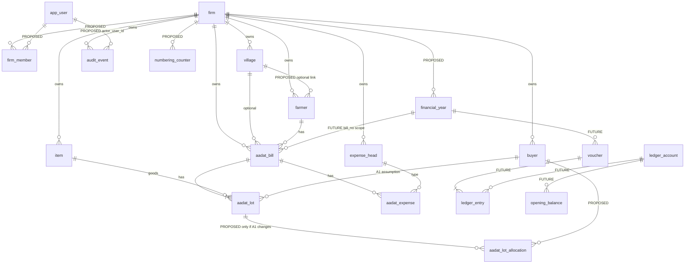

# Mandi Book: database architecture assessment and target schema (design only)

Date: 2026-10-20. **Nothing in this document has been implemented.** No application code, migration or data was changed; no load test was run and no large dataset was created. The only database access was **read-only catalog queries and `EXPLAIN` (never `ANALYZE`)** against the local synthetic dev database (`mandi_demo`).

Tags used throughout: **[F]** confirmed fact (read from the repository or the dev database) · **[R]** recommendation · **[A]** assumption · **[D]** decision needed from the business or product owner.

Related existing documents: `FIRM_ISOLATION.md`, `business-rules.md`, `ACCOUNTING_DATA_MODEL.md`, `ASSUMPTIONS.md`, `UNRESOLVED.md`. This report refines them and does not replace them.

---

## 1. Current-schema inventory [F]

Source: migrations `V1`–`V4`, repeatable seed `R__synthetic_demo_data.sql`, rollback `U4`, JPA entities, and a read-only catalog dump of the dev database (PostgreSQL 16.15).

### 1.1 Migrations
| Version | Content |
|---|---|
| V1 baseline | `village`, `farmer`, `buyer`, `item`, `expense_head` (all created with `like village including all`), `aadat_bill`, `aadat_lot`, `aadat_expense`, indexes on bill date and farmer |
| V2 | Seeds items Onion, Potato, Garlic |
| V3 | `audit_event` + index + triggers that reject UPDATE, DELETE and TRUNCATE |
| V4 | `firm` table, `DEFAULT` firm, `firm_id NOT NULL` on every business table and on `audit_event`, `(id, firm_id)` unique keys, composite foreign keys, `idx_*_firm` indexes |
| R__ (demo profile only) | Idempotent synthetic seed; `spring.flyway.locations` includes `db/seed` only under the `demo` profile |
| `db/rollback/U4` | Tested manual rollback of V4 (not scanned by Flyway) |

Dev database history also contains a `V1000` row from an older demo build; `spring.flyway.ignore-migration-patterns=*:missing,*:future` exists to tolerate it and is marked in `application.properties` to be removed for production.

### 1.2 Tables and columns
| Table | Columns (type, null) | Notes |
|---|---|---|
| `firm` | `id bigint identity PK`, `code varchar(30) NOT NULL UNIQUE`, `name varchar(200) NOT NULL`, `name_hi varchar(200)`, `active bool NOT NULL default true`, `created_at timestamptz NOT NULL default now()` | Read-only entity; created only by migration |
| `farmer`, `buyer`, `village`, `item`, `expense_head` (identical shape) | `id bigint identity PK`, `name varchar(200) NOT NULL`, `name_hi varchar(200)`, `active bool NOT NULL default true`, `created_at timestamptz NOT NULL default now()`, `firm_id bigint NOT NULL` | No uniqueness on name; no check that name is non-blank (application only) |
| `aadat_bill` | `id`, `bill_date date NOT NULL`, `farmer_id bigint NOT NULL`, `village_id bigint NULL`, `vehicle_no varchar(30) NULL`, `calculation_status varchar(30) NOT NULL`, `rule_set_id varchar(60) NOT NULL`, `created_at timestamptz NOT NULL`, `firm_id NOT NULL` | `calculation_status` has no CHECK against allowed values |
| `aadat_lot` | `id`, `bill_id NOT NULL`, `line_no int NOT NULL`, `item_id NOT NULL`, `pieces int NULL`, `weight numeric(18,6) NULL`, `rate numeric(18,6) NULL`, `buyer_id NULL`, `firm_id NOT NULL` | CHECKs `pieces >= 0`, `weight >= 0`, `rate >= 0` |
| `aadat_expense` | `id`, `bill_id NOT NULL`, `seq int NOT NULL`, `expense_head_id NOT NULL`, `amount numeric(18,6) NOT NULL`, `firm_id NOT NULL` | CHECK `amount >= 0` |
| `audit_event` | `id`, `entity_type varchar(40) NOT NULL`, `entity_id bigint NOT NULL`, `action varchar(30) NOT NULL`, `details varchar(1000)`, `actor varchar(100) NOT NULL default 'anonymous'`, `created_at timestamptz NOT NULL`, `firm_id NOT NULL` | Triggers block UPDATE, DELETE, TRUNCATE. `entity_id` is polymorphic (no FK, by design). The application truncates details to 1000 characters |

### 1.3 Keys, relationships, delete behaviour
| Relationship | Constraint | On delete/update |
|---|---|---|
| every table → `firm` | `*_firm_id_fkey (firm_id) → firm(id)` | no action |
| `aadat_bill` → `farmer`, `village` | **composite** `(farmer_id, firm_id) → farmer(id, firm_id)`; same for village | no action |
| `aadat_lot` → `aadat_bill` | composite `(bill_id, firm_id)` | **ON DELETE CASCADE** |
| `aadat_lot` → `item`, `buyer` | composite | no action |
| `aadat_expense` → `aadat_bill` | composite | **ON DELETE CASCADE** |
| `aadat_expense` → `expense_head` | composite | no action |
| `(id, firm_id)` UNIQUE on the five masters and on `aadat_bill` | exist only so composite FKs have a target | |
| `aadat_lot (bill_id, line_no)`, `aadat_expense (bill_id, seq)` | UNIQUE | |

No API deletes masters or bills (masters are deactivated; bills are read-only). The cascade matters only for administrative SQL.

### 1.4 Indexes
`aadat_bill`: pkey, `(id, firm_id)`, `idx_aadat_bill_date (bill_date)`, `idx_aadat_bill_farmer (farmer_id)`, `idx_aadat_bill_firm (firm_id)`. `aadat_lot`: pkey, `(bill_id, line_no)`, `idx_aadat_lot_firm`. `aadat_expense`: pkey, `(bill_id, seq)`, `idx_aadat_expense_firm`. `audit_event`: pkey, `idx_audit_entity (entity_type, entity_id, id)`, `idx_audit_event_firm`. Each master: pkey, `(id, firm_id)`, `idx_<t>_firm (firm_id)`. `firm`: pkey, `code` unique.
**Not indexed:** `aadat_bill.village_id`, `aadat_lot.item_id`, `aadat_lot.buyer_id`, `aadat_expense.expense_head_id`, any name/search column, any composite (firm, date) path.

### 1.5 Other facts from the dev database
- Application role `mandi` is **SUPERUSER, BYPASSRLS, and owns every table** [F]. Row-level security is off on all tables.
- `max_connections=100`, `statement_timeout=0`, `idle_in_transaction_session_timeout=0`, `log_min_duration_statement=-1`, only the `plpgsql` extension, no `pg_trgm`, no `pg_stat_statements`.
- Isolation level is the default `read committed`. Hikari pool is **not configured** (framework defaults).
- Volumes on the dev DB: 188 farmers, 154 bills, 300 audit events, one firm. Planner statistics were stale (`n_live_tup` showed 0 for tables holding rows), so plans below are shape-only.

### 1.6 How isolation is enforced today [F]
| Layer | Mechanism |
|---|---|
| Database | `firm_id NOT NULL` everywhere; **composite foreign keys** make a cross-firm reference impossible to write (tested by `FirmMigrationTest`). Reads are **not** protected by the database (no RLS, superuser connection) |
| Service | `CurrentFirm` (server-side, never from the request). Every list uses `firmId` in the specification; every id lookup uses `findByIdAndFirmId`; `AuditService.record` stamps the firm and uses `Propagation.MANDATORY` |
| Today's firm source | `SingleFirmContext`: one configured firm code, cached. No login exists |
| Tests | `FirmIsolationIntegrationTest` (5), `FirmMigrationTest` (4) |
| Repository surface | A grep of main code found **no** `findById`, `findAll()`, `deleteById`, `@Query` or native query. But repositories still inherit unscoped `JpaRepository` methods, so safety rests on convention (see §4) |

### 1.7 Gaps between entities, migrations and queries
1. JPA maps single-column joins (`farmer_id`) while the database holds composite FKs. That is correct only because the bill's own `firm_id` is set from the same value; the database catches any mismatch. [F]
2. Bill search filters by `firm_id`, sorts by `(bill_date desc, id desc)`, and optionally by farmer; indexes are single-column, so no index serves that shape (§3). [F]
3. Text search is `lower(col) LIKE '%q%'` with a leading wildcard; plain B-tree indexes cannot serve it (§3). [F]
4. `MasterService.list` returns **all** rows (no paging); bill search is paged (max 100) but runs a count query each time. [F]
5. Bill detail loads lots and expenses in batches, then lazily loads each lot's item and buyer and each expense's head individually: N+1 proportional to lots/expenses on one bill. Bill list reads `getLots().size()` for every row, loading the whole collection to count it. [F]
6. `calculation_status` and `rule_set_id` are free `varchar` in the database; the allowed set exists only in Java. [F]
7. `audit_event.details` is truncated at 1000 characters by the application; long descriptions lose their tail. [F]

---

## 2. Proposed normalized business schema

Principles [R]: every firm-owned table has `firm_id NOT NULL` and composite FKs; surrogate bigint keys; money and quantities as `numeric` with explicit precision; `timestamptz` for instants; nothing derived is stored until its rule is confirmed; posted financial rows are never updated or deleted (reversal instead); new nullable columns carry **no default** that affects accounting.

### 2.1 ER diagram (solid = exists today, "PROPOSED" / "FUTURE" = not built)

### 2.2 Table by table
| Table | Purpose | Firm ownership / keys | Key constraints | When |
|---|---|---|---|---|
| `firm` (exists) | Tenant | Root | `code` unique. Add later: status/suspension, base currency and time zone only if needed | now |
| `app_user` **[PROPOSED]** | Global login identity | Not firm-owned; a person may belong to several firms | unique login/email (case-insensitive), password hash or external subject id, `active` | with login (production plan item); needs an authentication decision [D] |
| `firm_member` **[PROPOSED]** | User ↔ firm with role | PK `(firm_id, user_id)` | role from a small closed set (`OWNER`, `OPERATOR` proposed), `active`; FK to `firm`, `app_user` | with login |
| `village`, `farmer`, `buyer`, `item`, `expense_head` (exist) | Masters | `firm_id`, `(id, firm_id)` unique | Add per-firm lookup indexes (§3). **Do not** add unique name constraints (same-name farmers are normal; pickers show name plus village) [D]. Optional typed attributes per the master-data audit (village: pin code, tehsil; farmer/buyer: village link, address, mobile; farmer number) as nullable columns; farmer/buyer village link via composite FK `(village_id, firm_id)` | attributes: soon |
| Item unit, commission % | Unresolved: see §6 | — | Do not add columns before the rule is confirmed | later |
| Expense calculation basis, rates, order, applicability | Unresolved: they may differ per firm | If ever built: a separate **versioned, firm-scoped rule table** (effective-dated, referenced by the bill's `rule_set_id`), not columns on `expense_head` | — | later |
| `aadat_bill` (exists) | Bill header | `firm_id`; `(id, firm_id)` unique | Add `CHECK (calculation_status in (...))` as a **separate small migration** once the value set is frozen. Later: `created_by` (user), `bill_no`/`financial_year_id` (nullable until numbering is decided), `version` for optimistic locking if bills become editable, name snapshots (see 2.3) | structure now; numbering/editing later |
| `aadat_lot` (exists) | Lot of goods | composite to bill, item, buyer | keep `buyer_id` while A1 stands | now |
| `aadat_lot_allocation` **[PROPOSED, conditional]** | Several buyers per lot (qty/weight/rate per buyer) | `firm_id`, composite to lot and buyer | Only if the business confirms split buyers [D]. Implemented since V11 as purchaser rows (`aadat_lot_buyer`). Keep `aadat_lot.buyer_id` for compatibility during any transition | later |
| `aadat_expense` (exists) | Recorded expense amount | composite to bill, head | `seq` = entry order only | now |
| `audit_event` (exists) | Append-only history | `firm_id` | Add `actor_user_id` (nullable, FK) when login exists, keep `actor` text as the name at the time; add `(firm_id, created_at)` index for admin views; decide retention/partitioning (§5). Consider a `jsonb` details column instead of 1000-character text [D] | now (index), later (actor) |
| `financial_year` **[PROPOSED]** | Firm's accounting year | `firm_id`; unique `(firm_id, label)` | Date range with a no-overlap exclusion constraint per firm; `status` open/closed. The financial year is 1 April to 31 March; use one row per year, not one database per year | with numbering |
| `numbering_counter` **[PROPOSED]** | Safe per-firm (and per-year) number allocation | PK `(firm_id, financial_year_id, series)` | `last_value bigint`; allocated with `UPDATE … RETURNING` inside the bill transaction; bill gets `UNIQUE (firm_id, financial_year_id, series, number)` | when Q7 is answered |
| `ledger_account`, `voucher`, `ledger_entry`, `opening_balance` **[FUTURE]** | Accounting | all `firm_id`, composite FKs | Principles only (no rules): posted rows immutable; a voucher's debits must equal credits, enforced by a deferred constraint trigger; reversal not deletion; `UNIQUE (firm_id, financial_year_id, voucher_type, number)`; amounts `numeric(18,2)`-class precision to be decided [D]; one account identity per party if a person can be both farmer and buyer. **Awaiting confirmed accounting rules (`business-rules.md`)** | blocked |

### 2.3 Historical snapshots [D]
Bills reference masters by id, so renaming a master changes how **old bills display**. Options: (a) store name snapshots on the bill (simple, cheap, covers display), (b) versioned master rows (heavier, needed only if rates/units must be reproducible), (c) accept current names. Copying the item unit onto each lot row would make bills reproducible. Decide before units or commission become part of a bill.

---

## 3. Scalability and query performance

### 3.1 Actual query shapes and what serves them [F] (plans are shape-only at ~150 rows; **no capacity claim**)
| Query (from code) | Current plan on dev DB | Problem at scale | Recommended index [R] |
|---|---|---|---|
| Bill list: `firm_id = ? [AND date range] [AND farmer] ORDER BY bill_date DESC, id DESC LIMIT n` + count | Seq scan, then sort, nested loop to farmer | No index gives firm + date order; sort of the whole firm's bills per page | `aadat_bill (firm_id, bill_date DESC, id DESC)`; farmer filter: `(firm_id, farmer_id, bill_date DESC, id DESC)`; after that `idx_aadat_bill_firm` is redundant and can be dropped |
| Bill list text search `lower(vehicle) / lower(farmer.name) / lower(name_hi) LIKE '%q%'` or `id = q` | Filter after row fetch | Leading wildcard defeats B-tree | Either switch to **prefix** search (`text_pattern_ops` on `lower(col)`) or add `pg_trgm` GIN indexes on `lower(name)`, `lower(name_hi)`, `lower(vehicle_no)` [D: which behaviour users expect]. Note Hindi (Devanagari) trigram behaviour must be tested |
| Bill filter by buyer (planned) | Not possible without scanning lots | — | `aadat_lot (firm_id, buyer_id, bill_id)`, plus `(firm_id, item_id, bill_id)` for item reports |
| Bill detail by id | Pkey/`(id, firm_id)` lookup; lots/expenses by `bill_id` | N+1 on item/buyer/head | Fetch with joins or batch the master lookups; no index change (`(bill_id, line_no)` and `(bill_id, seq)` already serve) |
| Master search `firm_id = ? AND active AND (lower(name) LIKE '%q%' OR lower(name_hi) …) ORDER BY name` | Index on `firm_id`, filter, sort | Whole firm's masters scanned and returned unpaged | `(firm_id, lower(name))`; trigram as above; **add paging** and a server limit |
| Audit history `firm_id = ? AND entity_type = ? AND entity_id = ? ORDER BY id DESC LIMIT 200` | Index scan on `(entity_type, entity_id, id)` + filter on firm | Fine while ids are unique per type; low selectivity risk is small | Keep; add `(firm_id, created_at DESC)` only when an admin "recent activity" screen is built |
| FK-support | `village_id`, `item_id`, `buyer_id`, `expense_head_id` unindexed | Joins and any future cascade/validation scan | Add the four FK-column indexes (include `firm_id` first) |

Create all indexes with `CREATE INDEX CONCURRENTLY` in non-transactional migrations (Flyway `executeInTransaction=false`); each is purely additive and rolls back by `DROP INDEX`.

### 3.2 Pagination, sorting, search
- **Bills** are paged with `OFFSET`; deep pages and the per-request `count(*)` degrade with firm size. [R] Use **keyset pagination** on `(bill_date, id)` for the list, and cap or approximate the total (or drop the exact total beyond a threshold).
- **Masters** are unpaged; a firm with thousands of parties will return thousands of rows to the browser. [R] Page and search server-side (type-ahead pickers) before the lists grow; keep `activeOnly` pickers limited.
- Sorting on `name` uses the database collation; confirm the collation for Hindi/English mixed names [D].

### 3.3 Pool, transactions, N+1
- Default Hikari settings, 100 server connections. [R] Set an explicit pool size per instance, `connectionTimeout`, `maxLifetime`; total connections across all instances must stay well under `max_connections`; consider PgBouncer (transaction pooling is compatible with `SET LOCAL`).
- Set server-side `statement_timeout`, `lock_timeout` and `idle_in_transaction_session_timeout` for the application role.
- Transactions today are short (one object graph insert + one audit insert). `open-in-view=false` is correct. Keep calculation and rendering outside transactions where possible.
- N+1: see §1.7 items 5; fix with fetch joins or aggregate count queries; add a query-count assertion in an integration test.

### 3.4 Future ledger queries (**future work, not designable until rules are confirmed**)
Expected shapes: account ledger by date range, running balance, trial balance by group, outstanding by party, voucher lookup by number. Likely indexes: `ledger_entry (firm_id, account_id, entry_date, id)`, `(firm_id, voucher_id)`, `voucher (firm_id, financial_year_id, voucher_type, number)`. Balances should be derived from entries (or a rebuildable summary table) (opening + debits − credits); re-posting a whole day by deleting and rebuilding it **must be avoided**.

---

## 4. Tenant isolation and security

### 4.1 Findings
| # | Finding | Severity | Evidence |
|---|---|---|---|
| S1 | **No authentication or authorization.** Every `/api/v1` endpoint is open; the firm is fixed on the server | High (blocker for any shared deployment) | `SingleFirmContext`; `ASSUMPTIONS A8` |
| S2 | **The application connects as a database SUPERUSER that owns all tables.** It can disable triggers, drop the audit protection, bypass RLS, truncate. The "append-only" guarantee therefore holds against application bugs, **not** against a compromised application credential or anyone with that password | High | role query; `mandi` has `rolsuper` and `rolbypassrls` |
| S3 | Dev password is in `application.properties` as a default and in `docker-compose.yml` (documented as dev-only) | Medium for production | files |
| S4 | Reads are protected only by service convention (`firmId` in every query). Repositories still expose inherited `findById`, `findAll()`, `deleteById`; nothing prevents a future call from using them | Medium | repository interfaces; grep shows none used today |
| S5 | Composite FKs prevent cross-firm **writes of references** but not cross-firm **reads** | Medium (by design) | V4 |
| S6 | Identity ids are sequential across all firms. Harmless while every lookup is firm-scoped; it becomes an enumeration aid if scoping ever breaks | Low | identity columns |
| S7 | `audit_event.actor` is always `anonymous`; no user, IP, request or correlation id | Medium for accountability | `AuditService.ANONYMOUS` |
| S8 | Future jobs/reports/exports have no request context and could run unscoped | Medium (future) | design |
| S9 | `CurrentFirm` caches the firm id in a field; correct for one firm, wrong if reused as a per-request component later | Low (today) | `SingleFirmContext` |
| S10 | Future unique codes (voucher numbers, party codes) must be unique **per firm**, never global | Design rule | — |

### 4.2 Recommended controls (none guarantees isolation alone)
1. **Two database roles:** an owner/migrator role for Flyway, and a **non-superuser runtime role** with only `SELECT/INSERT/UPDATE` (and `DELETE` where needed) on business tables, **`INSERT, SELECT` only on `audit_event`**, no `TRUNCATE`, no `CREATE`, no ownership. Then the audit triggers cannot be dropped or disabled by the application credential. (Infrastructure plus one small grant script; no schema change.)
2. **Row-level security as defence in depth:** policies `USING (firm_id = current_setting('app.firm_id')::bigint)` on every firm table, with the application executing `SET LOCAL app.firm_id = ?` at the start of each transaction (works with transaction pooling). Requires item 1 first (superusers bypass RLS). Cost: a per-transaction statement and policy overhead to be measured.
3. **Hibernate multi-tenancy discriminator (`@TenantId`)** or a base repository that hides unscoped methods, plus an **architecture test** that fails the build if any repository method without `FirmId` or a firm-scoped specification is invoked. Cheap and catches S4.
4. Authentication and per-endpoint roles (`FIRM_ISOLATION.md` §3), with the firm taken **only** from the authenticated membership.
5. Per-firm uniqueness rules written as `(firm_id, …)` constraints from the start.
6. Secrets from the environment or a secret store; rotate the dev defaults; TLS to the database in production.
7. Isolation tests per new endpoint (existing rule) plus a randomized cross-firm test harness once more than one firm exists.

---

## 5. Reliability and operations

| Topic | Today | What schema design can solve | What needs infrastructure/operations |
|---|---|---|---|
| Migration safety | Versioned Flyway, tested V4 rollback script, `pg_dump` before migrating (documented) | Expand/contract steps; additive nullable columns; `CHECK … NOT VALID` then `VALIDATE`; concurrent index builds; rollback scripts per migration | A staging database restored from production for rehearsal; lock/statement timeouts during migration; remove `ignore-migration-patterns` for production |
| Backup/restore | Manual `pg_dump` | — | Scheduled base backups + **WAL archiving (point-in-time recovery)** or a managed service; **restore drills** with a recorded RPO/RTO [D]; backup encryption and off-site copy |
| Data integrity | Composite FKs, CHECKs on non-negative values, NOT NULLs | Enumerated-value CHECKs, non-blank name CHECK, per-firm unique codes, balanced-voucher trigger (future), immutable posted rows | — |
| Audit retention | Unbounded, in the main table, triggers block deletion | Store structured details; plan partitioning by time (and possibly firm hash) when large | A legal/retention policy [D] (how long, how erasure requests interact with an append-only log), archival to cold storage |
| Failed transactions | One transaction per bill; change and audit commit together or not at all (tested) | Idempotency key per create request (`UNIQUE (firm_id, idempotency_key)`) so a client retry cannot create a duplicate | Retry policy with backoff at the client/gateway |
| Observability | Actuator `health,info` only | Audit/entity ids for correlation | `pg_stat_statements`, slow-query log, Hikari and request metrics, alerts on connection saturation, lock waits, replication lag, disk, bloat |
| Connection limits | Defaults | — | Pool sizing, PgBouncer, per-role connection limits |
| Statistics/vacuum | Stale stats observed on dev | — | Autovacuum tuning, scheduled `ANALYZE` after bulk loads |
| High availability | Single container | — | Replica/failover, health-checked failover, tested restore |

---

## 6. Concurrency and numbering

**Today [F]:** bill creation is safe from lost updates because each bill is one new row graph with an identity key; the shown "Ref" is the database id and is explicitly **not** an official number (A6). There is no `MAX(number) + 1` in the new application. Maximum-plus-one without locking is not safe under concurrent saves and must not be used.

**Required once a per-firm / per-financial-year number exists [R]:**
1. A counter row per `(firm_id, financial_year_id, series)` incremented by `UPDATE numbering_counter SET last_value = last_value + 1 WHERE … RETURNING last_value` **inside the same transaction as the bill insert**. The row lock serializes allocation per series only; different firms never contend.
2. A `UNIQUE (firm_id, financial_year_id, series, number)` constraint as the final guard.
3. Decide **gap policy** [D]: with this design a rolled-back transaction releases the number (no gap); a separate "cancel" policy decides whether cancelled numbers are reused. Sequences (`nextval`) are **not** gapless and must not be used if the business requires gapless numbering.
4. Idempotency key on create to stop duplicates from client retries or double clicks.
5. For edits: an optimistic-lock `version` column (reject stale updates) and a decision on whether bills may change after posting (Q9; deleting and re-inserting child rows would leave ledger entries stale, a risk to design out).
6. For future ledger posting: post inside one transaction; lock the voucher series row for number allocation; write immutable entries; use a deferred constraint trigger to enforce balanced vouchers; never "delete the day and rebuild".
7. Choose isolation per operation: `READ COMMITTED` with explicit row locks is enough for counters; use `SERIALIZABLE` with retry only where invariants span several rows and cannot be expressed as a constraint.

---

## 7. Unresolved business decisions [D]
| ID | Decision | Blocks |
|---|---|---|
| D1 | Item unit (what the rate is "per") and its role | Item columns, lot amount, per-lot unit copy |
| D2 | Commission: percentage of what, who pays, which bill/party | Item/commission columns, ledger |
| D3 | Expense calculation basis, rates, order, applicability, rounding row | Expense rule table |
| D4 | Opening balances: who has them, sign convention, year carry-forward | `opening_balance`, ledger |
| D5 | Official bill numbering: series, reset per year or never, gap policy, book/receipt/entry/WS numbers | `numbering_counter`, `bill_no` |
| D6 | Historical master snapshots: name copies, versions, or accept current names | Bill display, unit/commission reproducibility |
| D7 | Buyer relationship: per lot, per bill or several per lot | `aadat_lot_allocation` |
| D8 | Edit/cancel/void of saved bills (Q9) | `version`, status, reversal design |
| D9 | One party identity for farmer+buyer, or separate | Future `ledger_account` |
| D10 | Search behaviour (prefix vs substring, Hindi) and collation | Index choice |
| D11 | Authentication method and roles | `app_user`, `firm_member`, RLS |
| D12 | Audit retention and erasure policy | Audit storage |
| D13 | Whether rules may differ per firm; the product must not silently apply one firm's rules to another | Rule tables |

---

## 8. Phased migration plan (additive, backward compatible, each phase independently shippable)
| Phase | Content | Risk | Compatibility | Rollback |
|---|---|---|---|---|
| **0. Safety baseline** (no schema change) | Verified backup and restore rehearsal; run `ANALYZE`; set pool size and timeouts; enable `pg_stat_statements` and slow-query log in non-production first; repository guard test (S4) | Low | none affected | Revert configuration |
| **1. Least-privilege role and additive indexes** | Create runtime role (S2), switch the application to it, re-run every test including audit triggers; add composite and FK indexes with `CONCURRENTLY` (§3.1) | Low–medium (role privileges may be missing for some statement; index builds use I/O) | No API or data change | Point the app back at the old role; `DROP INDEX` |
| **2. Query/API shape improvements** | Keyset bill pagination, paged masters, fix N+1, aggregate lot count; keep existing parameters working (`page`/`size` accepted until the frontend moves) | Medium (API behaviour) | Additive query parameters; old calls keep working | Revert code |
| **3. Master attributes** (per the master-data audit) | Nullable columns, village first; composite FK for farmer/buyer village link | Low | Responses additive; old clients ignore new fields | Tested `U<n>` script dropping the columns |
| **4. Identity and membership** | `app_user`, `firm_member`, authentication, `CurrentFirm` from the user, `audit_event.actor_user_id`; keep `SingleFirmContext` behind a profile for the demo | **High** (touches every request) | Demo profile unchanged | Feature flag back to `SingleFirmContext`; tables can stay unused |
| **5. Defence in depth** | RLS policies + `SET LOCAL app.firm_id`, only after phases 1 and 4 | Medium (performance, missed setting fails closed) | None for API | `ALTER TABLE … DISABLE ROW LEVEL SECURITY` |
| **6. Financial year and numbering** | `financial_year`, `numbering_counter`, nullable `bill_no`; only after D5 | Medium | Existing bills keep a null number; "Ref" stays | Drop new tables/columns (nullable, unused) |
| **7. Allocation / snapshots / editing** | After D6–D8, D7 | Medium–high | Keep `aadat_lot.buyer_id` during transition | Drop new tables |
| **8. Accounting** | After D1–D4 and all rules confirmed; vouchers, entries, balances | High | New tables only | Dedicated rollback plan |

All schema phases follow the existing rules: Flyway versioned migration, rollback script, `pg_dump` first, `FirmMigrationTest` extension, an isolation test per new endpoint, audit in the same transaction, and no migration in `db/seed`.

---

## 9. Scale-validation plan (**no capacity is claimed; nothing here has been run**)

### 9.1 Method
Isolated PostgreSQL 16 instance sized like the intended production tier; synthetic data generated with `generate_series` (no real data); realistic **skew** (a few very large firms, many small); application tier as deployed (including the pool and, if used, PgBouncer); load tool (for example k6 or Gatling) driving the REST API; measurements from the client, `pg_stat_statements`, and host metrics. Warm-up period, then steady state, then a spike.

### 9.2 Scenarios and assumptions (all numbers are **assumptions to be agreed**, not facts)
| | A. Small pilot | B. About 1,000 registered users | C. 100,000+ registered users |
|---|---|---|---|
| Firms | 1–5 | 100–300 | 5,000–20,000 |
| Registered users | ≤ 20 | 1,000 | 100,000+ |
| Assumed concurrent active sessions | 5 | 50–100 (5–10% of registered) | 1,000–5,000 (1–5%) |
| Assumed request rate (peak) | 2–5 req/s | 20–50 req/s | 300–1,500 req/s |
| Bills per firm per year (assumption) | 5,000 | 5,000 (a few firms 100,000) | 5,000 (a few firms 100,000) |
| Rows (bills × ~3 lots × ~2 expenses; audit ≈ 2 per bill) | ≈ 25k bills | ≈ 1.5 M bills, ≈ 4.5 M lots | ≈ 100 M bills, ≈ 300 M lots |
| Masters per firm | 500–2,000 | 500–2,000 | 500–2,000 |
| Purpose | Prove correctness, tooling, baseline | Find first bottleneck; validate pool, indexes, paging | Decide whether partitioning, replicas, pooler tier, tenant sharding are needed |

### 9.3 Workload mix per scenario [assumption: adjust with the business]
~60% bill list/search (date range, farmer, text), ~15% master pick-lists and search, ~15% bill detail, ~8% bill create (with 1–4 lots, 0–3 expenses), ~2% master create/update/deactivate, plus audit-history reads. Ledger queries are excluded until they exist.

### 9.4 Specific tests
1. **Query plans at volume:** `EXPLAIN (ANALYZE, BUFFERS)` of every query in §3.1 on the generated data, before and after the proposed indexes; confirm index use and absence of full-firm sorts.
2. **Concurrent create:** N parallel bill creates for one firm and for many firms; assert no errors, no duplicate numbers once numbering exists, bounded lock wait.
3. **Tenant isolation under load:** randomized cross-firm id probing returns 404 for 100% of foreign ids; no cross-firm rows in any list.
4. **Noisy neighbour:** one large firm running heavy searches while small firms operate; measure the small firms' latency.
5. **Pool exhaustion:** raise concurrency beyond the pool; confirm timeouts return controlled errors, not hangs.
6. **Failure and recovery:** kill the application mid-transaction (no partial bill, no orphan audit row); database restart; **restore from backup and measure the restore time**.
7. **Migration rehearsal:** run each new migration against the large dataset; record lock durations.
8. **Autovacuum/bloat and audit growth** over a long soak (≥ 4 hours).

### 9.5 Measurements and proposed acceptance criteria (**proposals; need owner approval**)
| Metric | Proposed criterion at the agreed load |
|---|---|
| Bill list/search p95 | ≤ 300 ms; p99 ≤ 800 ms |
| Master pick-list p95 | ≤ 200 ms |
| Bill detail p95 | ≤ 300 ms |
| Bill create p95 | ≤ 500 ms; p99 ≤ 1,200 ms |
| Error rate (5xx, timeouts) | < 0.1% over steady state |
| Database connections | < 70% of `max_connections` at peak; no pool-timeout errors |
| Lock waits / deadlocks | No deadlocks; p95 lock wait < 50 ms |
| CPU / IO | CPU < 70% sustained; no sustained IO saturation |
| Isolation probes | 0 cross-firm leaks |
| Restore | Restore of the largest test dataset within the agreed RTO |
| Migration | Online migration lock time < 1 s per statement (index builds concurrent) |

### 9.6 Decision criteria for further scaling measures
- Add **PgBouncer / pooler tier** when application instances × pool size approaches 60% of `max_connections` or connection setup shows in latency.
- Add a **read replica** for reports/search when read CPU or IO is the limiter and replica lag stays inside the staleness the product accepts.
- **Partition** `audit_event` (and future `ledger_entry`) by time when a table passes a size where autovacuum, index maintenance or retention deletes miss targets (a starting point to be validated: hundreds of millions of rows or hundreds of GB).
- Consider **tenant sharding or cell-based deployment** only if scenario C fails after the above, or if one firm's load threatens others.
- If any acceptance criterion fails, fix the cause shown by the plans (index, query shape, pool) first; do not scale hardware blindly.

---

## 10. Facts, recommendations, assumptions: summary
**Confirmed facts [F]:** the schema, constraints, indexes and role attributes in §1; composite foreign keys enforce same-firm references; reads depend on service-level scoping; the app role is a superuser; no authentication; no pool or timeout configuration; no unique or search indexes; masters list unpaged; N+1 patterns exist on bill detail; no numbering logic beyond the database id; no ledger tables.
**Recommendations [R]:** least-privilege runtime role; composite and FK indexes created concurrently; keyset pagination and paged masters; fix N+1; repository guard test and later RLS; counter-table numbering with a unique constraint; versioned rule tables rather than columns for unverified rules; additive migrations with tested rollbacks; operations items in §5.
**Assumptions [A]:** all user counts, firm counts, bills per firm, request rates and latency targets in §9; that same-name farmers are legitimate; that Hindi search behaviour needs testing; that audit rows will outgrow a single table over time.

## 11. Recommended safest first implementation phase
**Phase 0 + Phase 1: "Safety baseline, least-privilege database role, and additive indexes."** It changes **no** table structure, no API and no behaviour; it fixes the most serious finding (the superuser application connection, S2) so the append-only audit guarantee becomes meaningful; the indexes are additive and reversible with `DROP INDEX`; and it produces the measurements (`pg_stat_statements`) needed to judge everything after it. Pre-conditions: a verified backup and restore rehearsal, and the full backend and browser suites passing against the new role. Authentication (Phase 4) and any accounting table must wait for their decisions (D11, D1–D5).

**Awaiting your approval before anything is implemented.**
